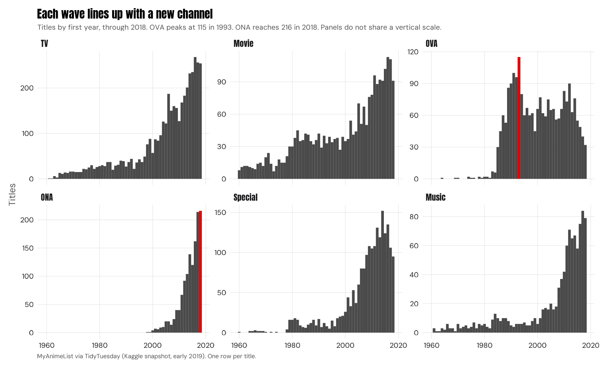
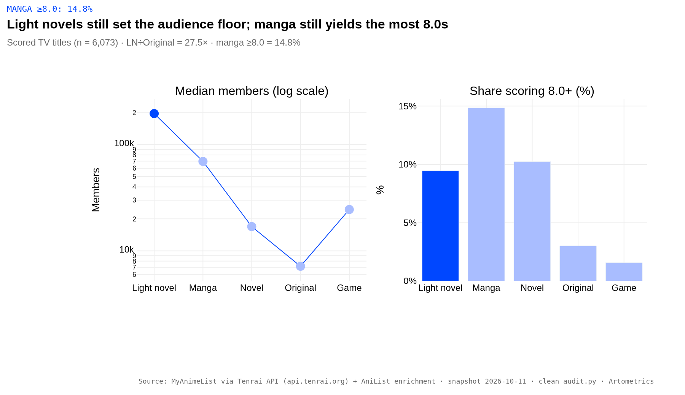
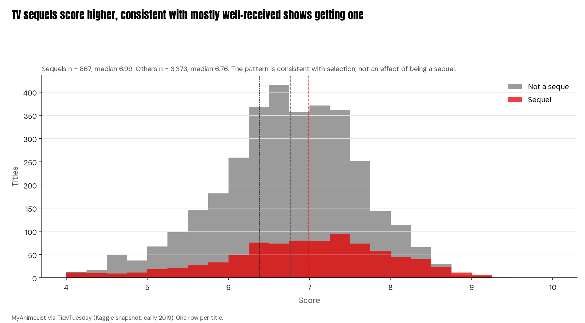
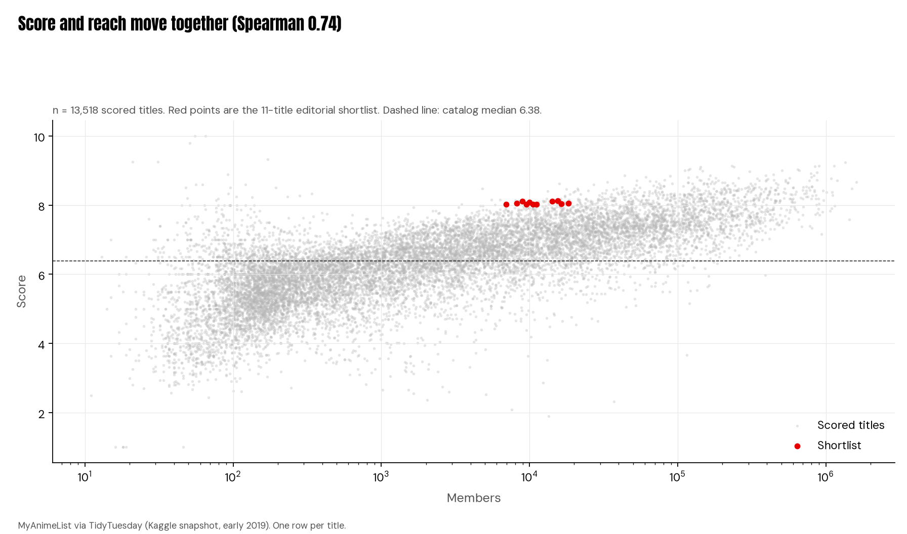

::: {.exec-summary}
## Key findings {.unlisted}

Across 13,631 MyAnimeList titles from 1917 to an early-2019 snapshot, source material is the strongest single signal of a TV anime's reach. At the median, light-novel adaptations draw 153,184 members and original series draw 4,738. Quality is harder to buy. Only 4.6% of original TV series and 0.5% of TV game adaptations score 8.0 or higher as of that snapshot, against 17.0% of manga adaptations. Both patterns reflect which projects get greenlit as much as how good they are, and the platform measures English-language enthusiast sentiment, not revenue.

::: {.cards}
::: {.card}
::: {.stat}
32x
:::

median members, light-novel TV adaptations vs original TV series (153,184 vs 4,738)
:::
::: {.card}
::: {.stat}
4.6%
:::

share of original TV series scoring 8.0 or higher (n = 1,012)
:::
::: {.card}
::: {.stat}
0.5%
:::

share of TV game adaptations scoring 8.0 or higher, as of the early-2019 snapshot (1 of 210)
:::
::: {.card}
::: {.stat}
0.74
:::

rank correlation between score and member count (n = 13,518)
:::
::: {.card}
::: {.stat}
11
:::

stand-alone high scorers buried past popularity rank 3,000
:::
:::
:::

::: {.lede}
*Death Note* has 1,610,561 MyAnimeList members, more than any other anime in the archive, and scores 8.66. *Hanada Shounen-shi*, a 2002 series from the same studio, Madhouse, scores 8.11 and has 8,929. A MyAnimeList archive of 13,631 titles, from 1917 to an early-2019 snapshot, suggests that much of a gap like that is set before anyone draws a frame, starting with where the story comes from.
:::

On television, light-novel adaptations draw a median of 153,184 platform members. Manga adaptations draw 37,500 and original series 4,738, which puts light novels about 32 times ahead of originals. Quality follows a different pattern. Only 4.6% of original TV series and 0.5% of TV game adaptations score 8.0 or higher as of the early-2019 snapshot, compared with 17.0% of manga adaptations. Across all scored titles, a title's score and its audience move closely together, with a rank correlation of 0.74. Every comparison below is measured against the overall median score of 6.38.

::: {.sidebox}
::: {.kicker}
Mechanism
:::

This report reads the archive as the record of a production system, not a list of favorites. In that system, a production committee (seisaku iinkai) of publishers, broadcasters, music labels, and merchandisers pools the budget and splits copyright in proportion to each member's investment. The animation studio is typically a contracted manufacturer that doesn't own the IP (Hernández Hernández, 2018, §4.3; Mihara, 2018). The figures here are observed fan behavior on one platform. They show which projects found audiences, not which ones made money.
:::

::: {.pullquote}
::: {.stat}
32 : 1
:::

On television, light-novel adaptations draw a median of 153,184 platform members. Manga adaptations draw 37,500 and original series 4,738, which puts light novels about 32 times ahead of originals.
:::

## RESEARCH QUESTION {#research-question}

Which decisions made before production (format, source material, studio, and whether to make a sequel) are associated with a title's reach and fan rating, and where does the platform's popularity record miss strong work?

::: {.chart-page}
## Each format wave lines up with a new distribution channel {#format-waves}
{width=5.85in fig-alt="Small multiples of anime releases by year for TV, film, OVA, ONA, specials, and music, through 2018. OVA peaks in 1993 and ONA rises through 2018."}

::: {.credit}
Data: MyAnimeList via TidyTuesday (Kaggle snapshot, early 2019) — ARTOMETRICS
:::
:::

Anime output is not one growth curve. It's a series of format waves, and each wave lines up with a new channel. Theatrical film dominates the early catalog. Original video animation (OVA), sold directly on tape and disc, ran at roughly 100 titles a year from 1990 to 1993 and peaked at 115 in 1993. Television then became the core of the catalog, with 4,260 TV titles in the archive. Original net animation (ONA), made for web distribution first, grew from 40 titles in 2009 to 104 in 2013 and 216 in 2018, for 1,321 in total.

The archive records release format, not financing. Reading these waves as responses to new distribution channels is our editorial frame, not a measured finding, and the data can't show who paid for each wave. The context literature documents one wave directly: starting with Tetsuwan Atom (1963), TV anime was tied to sponsor merchandising (Steinberg, 2012).

::: {.spread}
::: {.copy}

### Direct-to-video

The first OVA, *Dallos* (Studio Pierrot, December 1983), was co-directed by Mamoru Oshii (Pierrot archive; Anime News Network). The format became known for high production values and experimentation (Anime News Network, 2022). Its standouts include *Ginga Eiyuu Densetsu* (*Legend of the Galactic Heroes*, 1988), a 110-episode space epic that scores 9.10, the only OVA in the top 10 by score. *Golden Boy* (1995) drew the era's largest audience, 171,713 members, and Gainax's *Gunbuster* (1988) also stands out.

:::

::: {.side}

::: {.logo}
{width=1.25in fig-alt="Studio Pierrot"}

::: {.credit}
Studio Pierrot logo via Wikimedia Commons (public domain, PD-textlogo; trademark of its owner)
:::
:::

::: {.logo}
{width=1.25in fig-alt="Gainax"}

::: {.credit}
Gainax logo via Wikimedia Commons (public domain, PD-textlogo; trademark of its owner)
:::
:::

::: {.person}
{width=1.15in fig-alt="Mamoru Oshii"}

**Mamoru Oshii**

Co-director of *Dallos* (Studio Pierrot, December 1983), the first OVA.

::: {.credit}
Photo: Niccolò Caranti / Wikimedia Commons, CC BY-SA 4.0
:::
:::
:::
:::

::: {.spread}
::: {.copy}

### Television

Production committees became the standard way to finance TV anime, and by 2010 nearly 80% of anime was made this way, according to Taniguchi and Asō (2010) as reported by Hernández Hernández (2018). The biggest titles in the archive come from this era: *Death Note* (Madhouse, 2006), which aired after midnight on NTV, *Fullmetal Alchemist: Brotherhood* (Bones, 2009), *Naruto* (Studio Pierrot, 2002), and *Code Geass* (Sunrise, 2006). After 2010, *Shingeki no Kyojin* (*Attack on Titan*, Wit Studio, 2013) reached 1,500,958 members, second only to *Death Note*.

:::

::: {.side}

::: {.logo}
{width=1.25in fig-alt="Nippon TV"}

::: {.credit}
Nippon TV (NTV) logo via Wikimedia Commons (public domain, PD-textlogo; trademark of its owner)
:::
:::

::: {.logo}
{width=1.25in fig-alt="Madhouse"}

::: {.credit}
Madhouse logo via Wikimedia Commons (public domain, PD-textlogo; trademark of its owner)
:::
:::

::: {.logo}
{width=1.25in fig-alt="Wit Studio"}

::: {.credit}
Wit Studio logo via Wikimedia Commons (public domain, PD-textlogo; trademark of its owner)
:::
:::

::: {.logo}
{width=1.25in fig-alt="Sunrise"}

::: {.credit}
Sunrise logo via Wikimedia Commons (public domain, PD-textlogo; trademark of its owner)
:::
:::
:::
:::

::: {.spread}
::: {.copy}

### Web-first

Crunchyroll switched to licensed-only streaming in 2008, and in January 2009 it began streaming *Naruto Shippuden* on the same day as its Japanese broadcast. The ONA's biggest title is *Devilman: Crybaby* (Science SARU), a Netflix original released January 5, 2018, with 261,525 members (Netflix Media Center; Anime News Network). The Chinese production *Quanzhi Gaoshou* (*The King's Avatar*, 2017, 8.09) shows the format crossing borders.

:::

::: {.side}

::: {.logo}
{width=1.25in fig-alt="Crunchyroll"}

::: {.credit}
Crunchyroll logo via Wikimedia Commons (CC0)
:::
:::

::: {.logo}
{width=1.25in fig-alt="Science SARU"}

::: {.credit}
Science SARU logo via Wikimedia Commons (public domain, PD-textlogo; trademark of its owner)
:::
:::

::: {.logo}
{width=1.25in fig-alt="Netflix"}

::: {.credit}
Netflix logo via Wikimedia Commons (public domain, PD-textlogo; trademark of its owner)
:::
:::
:::
:::

::: {.spread}
::: {.copy}

### For scale, beyond this dataset

The Association of Japanese Animations put the Japanese anime industry market at ¥2,180.7 billion in 2018 and ¥3,346.5 billion in 2023, the year overseas sales passed domestic ones (AJA, English summaries). That is the whole industry's market, not studio revenue.

:::

::: {.side}

::: {.logo}
{width=1.25in fig-alt="Association of Japanese Animations"}

::: {.credit}
Association of Japanese Animations (AJA) logo via Wikimedia Commons (public domain, PD-textlogo; trademark of its owner)
:::
:::
:::
:::

::: {.chart-page}
## Source material sets the audience floor {#source-floor}
{width=5.85in fig-alt="Two panels of scored TV anime by source: median members as lollipops on a log scale, and the share scoring 8.0 or higher as bars."}

::: {.credit}
Data: MyAnimeList via TidyTuesday (Kaggle snapshot, early 2019) — ARTOMETRICS
:::
:::

<table class="art-table"><thead><tr><th>Source (TV)</th><th>Titles</th><th>Median score</th><th>Median members</th><th>Share scoring 8.0+</th></tr></thead><tbody>
<tr><td>Light novel</td><td>283</td><td>7.35</td><td>153,184</td><td>13.1%</td></tr>
<tr><td>Manga</td><td>1,232</td><td>7.29</td><td>37,500</td><td>17.0%</td></tr>
<tr><td>Novel</td><td>122</td><td>7.13</td><td>10,489</td><td>15.6%</td></tr>
<tr><td>Original</td><td>1,012</td><td>6.63</td><td>4,738</td><td>4.6%</td></tr>
<tr><td>Game</td><td>210</td><td>6.63</td><td>14,005</td><td>0.5%</td></tr>
</tbody></table>

::: {.spread}
::: {.copy}

### The light-novel giants

Some of the biggest shows on the site sit behind the 153,184 median. *Sword Art Online* (A-1 Pictures, 2012) has 1,442,099 members, the third-largest audience in the archive, yet it scores 7.58, which shows reach and rating moving apart. *No Game No Life* (Madhouse, 2014) and *Toradora!* (J.C.Staff, 2008) both pass a million members and both score 8.38. A typical adaptation is smaller: *Mahou Sensou* sits at exactly the median, with 153,184 members.

:::

::: {.side}

::: {.logo}
{width=1.25in fig-alt="A-1 Pictures"}

::: {.credit}
A-1 Pictures logo via Wikimedia Commons (public domain, PD-textlogo; trademark of its owner)
:::
:::

::: {.logo}
{width=1.25in fig-alt="J.C.Staff"}

::: {.credit}
J.C.Staff logo via Wikimedia Commons (public domain, PD-textlogo; trademark of its owner)
:::
:::
:::
:::

::: {.spread}
::: {.copy}

### The originals that broke through

The median original TV series draws 4,738 members, but the exceptions rank among the site's biggest. *Code Geass* (Sunrise, 2006) has 1,082,349 members and scores 8.77. *Angel Beats!* (P.A. Works, 2010) has 1,105,583. Outside TV, the original film *Kimi no Na wa.* (*Your Name.*, CoMix Wave Films, 2016) scores 9.14, tied for second among titles with at least 1,000 ratings. Originals can reach the top, but only 4.6% of original TV series score 8.0 or higher.

:::

::: {.side}

::: {.logo}
{width=1.25in fig-alt="P.A. Works"}

::: {.credit}
P.A. Works logo via Wikimedia Commons (public domain, PD-textlogo; trademark of its owner)
:::
:::

::: {.logo}
{width=1.25in fig-alt="CoMix Wave Films"}

::: {.credit}
CoMix Wave Films logo via Wikimedia Commons (public domain, PD-textlogo; trademark of its owner)
:::
:::
:::
:::

::: {.spread}
::: {.copy}

### The one TV game adaptation above 8.0

*IDOLiSH7* (2018) adapts Bandai Namco Online's smartphone idol rhythm game. TROYCA animated it from character designs by the manga artist Arina Tanemura (official announcement, idolish7.com, Jan 17, 2017; Anime News Network, 2017). As of the early-2019 snapshot, its 17 episodes scored 8.06, making it the only TV game adaptation at 8.0 or higher (1 of 210), but it had just 18,254 members. Its live MAL score has since slipped to 7.69 (October 2026) as its raters grew from 4,788 to 26,755, so the 8.06 rested on a small, early sample. A later game adaptation, *Cyberpunk: Edgerunners* (Trigger, 2022), was released as a Netflix ONA rather than a TV series; it scores 8.62 on MAL as of October 2026. In the early-2019 snapshot, the next-best game adaptations are *Gungrave* (7.93) and *Pokémon XY&Z* (7.77).

:::

::: {.side}

::: {.logo}
{width=1.25in fig-alt="TROYCA"}

::: {.credit}
TROYCA logo via Wikimedia Commons (public domain, PD-textlogo; trademark of its owner)
:::
:::

::: {.logo}

**Bandai Namco Online**
:::

::: {.person}

**Arina Tanemura**

Manga artist. TROYCA animated *IDOLiSH7* from her character designs (official announcement, idolish7.com, Jan 17, 2017; Anime News Network, 2017).
:::
:::
:::

The source of a story, its gensaku, is the biggest single dividing line in the TV catalog. Light-novel adaptations have the highest median score (7.35) and by far the largest median audience. They reach about four times as many members as manga adaptations and about 32 times as many as originals. That gap measures audience size, not quality or staying power. It also compares typical shows, not the best ones: 62 of 1,012 original TV series (6.1%) draw more members than the median light-novel adaptation, while only 3 of 283 light-novel series fall below the median original. Manga adaptations are close behind on score (7.29), and they produce the highest share of top-rated shows, at 17.0% scoring 8.0 or higher (210 of 1,232).

::: {.sidebox}
::: {.kicker}
Mechanism
:::

The mechanism is the media mix. A story is built across print, animation, music, and merchandise at once (Steinberg, 2012). On our reading, a published book also serves as a live test of demand before a committee commits money to animation. This is selection, not proof that adapting a book lowers risk. Committees adapt titles that already have readers, so some of that audience is arriving with the book.
:::

Originals face the opposite problem. Their median score is 6.63, and only 4.6% reach 8.0 or higher. With no print run to test demand first, an original has to prove itself on air. Game adaptations are the weakest group by fan rating. Their median is 6.63, and as of the early-2019 snapshot only 0.5% of TV game adaptations score 8.0 or higher (1 of 210). For a committee, one practical reading is that a game adaptation is better budgeted as part of the game's marketing than as the start of a stand-alone animated franchise. That reading is an editorial frame, not a result the file measures.

::: {.pullquote}
::: {.stat}
4.6%
:::

Their median score is 6.63, and only 4.6% reach 8.0 or higher.
:::

::: {.chart-page}
## Consistency is a studio trait {#studio-league}
{width=5.85in fig-alt="Dot plot of median scores for 20 studios with at least 100 titles, with interquartile bars. Bones, Kyoto Animation, and OLM are marked in red."}

::: {.credit}
Data: MyAnimeList via TidyTuesday (Kaggle snapshot, early 2019) — ARTOMETRICS
:::
:::

In a system where the committee owns the project, the animation studio is usually the prime contractor (motouke), and much of the drawing is subcontracted (shitauke) to other studios and freelancers (Hanzawa, 2004). Inside a studio, production managers (seisaku shinkou) coordinate the work but depend on key creatives, whose drawing skill routinely gives them the upper hand (Morisawa, 2015). That makes a studio's typical output a better guide to what a commission will deliver than its single biggest hit.

Bones has 115 titles, a median of 7.46, an interquartile range (IQR, the spread of the middle half of its scores) of 0.95, and 23.5% of its titles scoring 8.0 or higher, the tightest spread among the top-scoring studios (only 7th-tightest of all 20). Kyoto Animation's 110 titles have a median of 7.43 and an IQR of 1.22. Kyoto Animation employs mostly salaried in-house staff and trains animators through its own school, which is unusual in an industry built on subcontracting (Creamer, 2015; Moore, 2017; Kyoto Animation training school). OLM is the counterexample that makes the point. Its 209 titles have a median of only 6.64, but its IQR of 0.70 is the tightest of any studio with 100 or more titles. It delivers a predictable product at a modest level.

For anyone choosing a prime contractor, the decision metric is a studio's median and spread, not its best-known title. Across the 20 studios with 100 or more scored titles, median scores run from 7.46 (Bones) down to 5.40 (DLE). DLE (n = 153) mostly makes short-form titles, with a median episode of 3 minutes, so its median score isn't directly comparable to studios making 24-minute episodes. Bones and OLM have a 24-minute median episode. The largest studio, Toei (737 titles), sits near the bottom of the table at 6.68. Of those titles, 2.8% score 8.0 or higher (21 of 737).

<table class="art-table"><thead><tr><th>Studio</th><th>n</th><th>Median</th><th>Middle 50%</th><th>IQR</th><th>Share 8.0+</th></tr></thead><tbody>
<tr><td>Bones</td><td>115</td><td>7.46</td><td>6.95–7.90</td><td>0.95</td><td>23.5%</td></tr>
<tr><td>Kyoto Animation</td><td>110</td><td>7.43</td><td>6.67–7.89</td><td>1.22</td><td>20.9%</td></tr>
<tr><td>A-1 Pictures</td><td>190</td><td>7.31</td><td>6.70–7.73</td><td>1.03</td><td>14.7%</td></tr>
<tr><td>Shaft</td><td>125</td><td>7.25</td><td>6.65–7.86</td><td>1.21</td><td>16.8%</td></tr>
<tr><td>Studio Deen</td><td>264</td><td>7.20</td><td>6.53–7.63</td><td>1.10</td><td>8.3%</td></tr>
<tr><td>Production I.G</td><td>297</td><td>7.16</td><td>6.46–7.71</td><td>1.25</td><td>13.5%</td></tr>
<tr><td>Madhouse</td><td>340</td><td>7.03</td><td>6.47–7.61</td><td>1.15</td><td>15.9%</td></tr>
<tr><td>Gonzo</td><td>123</td><td>7.01</td><td>6.40–7.33</td><td>0.93</td><td>2.4%</td></tr>
<tr><td>J.C.Staff</td><td>322</td><td>7.01</td><td>6.25–7.42</td><td>1.17</td><td>7.5%</td></tr>
<tr><td>Sunrise</td><td>457</td><td>7.00</td><td>6.43–7.46</td><td>1.03</td><td>6.8%</td></tr>
<tr><td>TMS Entertainment</td><td>275</td><td>6.99</td><td>6.28–7.53</td><td>1.26</td><td>10.2%</td></tr>
<tr><td>Xebec</td><td>146</td><td>6.99</td><td>6.57–7.37</td><td>0.80</td><td>2.1%</td></tr>
<tr><td>Studio Pierrot</td><td>251</td><td>6.87</td><td>6.27–7.48</td><td>1.21</td><td>6.0%</td></tr>
<tr><td>AIC</td><td>111</td><td>6.82</td><td>6.30–7.22</td><td>0.93</td><td>0.9%</td></tr>
<tr><td>Toei Animation</td><td>737</td><td>6.68</td><td>6.16–7.23</td><td>1.07</td><td>2.8%</td></tr>
<tr><td>Nippon Animation</td><td>206</td><td>6.67</td><td>6.31–7.12</td><td>0.81</td><td>3.4%</td></tr>
<tr><td>OLM</td><td>209</td><td>6.64</td><td>6.36–7.06</td><td>0.70</td><td>0.5%</td></tr>
<tr><td>Shin-Ei Animation</td><td>156</td><td>6.63</td><td>6.08–7.25</td><td>1.17</td><td>0.6%</td></tr>
<tr><td>Tatsunoko Production</td><td>158</td><td>6.53</td><td>6.14–7.01</td><td>0.86</td><td>3.8%</td></tr>
<tr><td>DLE</td><td>153</td><td>5.40</td><td>4.96–5.94</td><td>0.98</td><td>0.7%</td></tr>
</tbody></table>

Each card links its numbers to its history. The links are our reading, not measured effects. The section takes its numbers from the league table above and adds no new chart.

::: {.spread}
::: {.copy}

### Bones

115 titles, median 7.46, IQR 0.95. Its signature titles are *Fullmetal Alchemist: Brotherhood* (2009), the highest-scoring title in the archive at 9.24 with 1,355,349 members, plus *My Hero Academia* (2016) and *Mob Psycho 100 II* (8.71). Sunrise producer Masahiko Minami founded Bones in 1998 with the animators Hiroshi Ōsaka and Toshihiro Kawamoto, all from the Sunrise team behind *Cowboy Bebop*. Minami brought freelance animators in as salaried staff, and the studio works in independent sub-studios (Morrissy, Anime News Network, 2018). A selective studio with a veteran core is consistent with a high median and a tight spread.

:::

::: {.side}

::: {.studio-card}
{width=1.3in fig-alt="Bones"}

::: {.credit}
Bones logo via Wikimedia Commons (public domain, PD-textlogo; trademark of its owner)
:::

### Bones
- Titles **115**
- Median **7.46**
- IQR **0.95**
- Founded **1998**

*Fullmetal Alchemist: Brotherhood* (2009), *My Hero Academia* (2016), *Mob Psycho 100 II* (8.71).

Sunrise producer Masahiko Minami founded Bones in 1998 with the animators Hiroshi Ōsaka and Toshihiro Kawamoto, all from the Sunrise team behind *Cowboy Bebop*. Minami brought freelance animators in as salaried staff, and the studio works in independent sub-studios (Morrissy, Anime News Network, 2018).

Median 7.46 · range 5.40–7.46

::: {.person}
{width=1.15in fig-alt="Masahiko Minami"}

**Masahiko Minami**

Sunrise producer. Founded Bones in 1998 and brought freelance animators in as salaried staff.

::: {.credit}
Photo: Georges Seguin (Okki) / Wikimedia Commons, CC BY-SA 3.0
:::
:::

::: {.person}
{width=1.15in fig-alt="Toshihiro Kawamoto"}

**Toshihiro Kawamoto**

Animator and co-founder, from the Sunrise team behind *Cowboy Bebop*.

::: {.credit}
Photo: Michael Ocampo / Wikimedia Commons, CC BY 2.0
:::
:::

::: {.person}

**Hiroshi Ōsaka**

Animator and co-founder, with Minami and Kawamoto, from the Sunrise team behind *Cowboy Bebop*.
:::
:::
:::
:::

::: {.spread}
::: {.copy}

### Kyoto Animation

110 titles, median 7.43, IQR 1.22. Its signature titles are *Koe no Katachi* (*A Silent Voice*, 2016, 9.03), *Clannad: After Story* (2008, 9.00), and *Suzumiya Haruhi no Shoushitsu* (2010, 8.71). Founded in 1981 in Uji, Kyoto, it trains its own animators and hires them on contract with a route to salaried staff, converting most of them (company hiring page; Creamer, 2015; Moore, 2017). Its own book imprint, KA Esuma Bunko, supplies some of its source novels. Its spread is wider than Bones', partly because 43 of its 110 scored titles are specials. Leaving specials out, Kyoto Animation's median is 7.62 with an IQR of 0.99 (n = 67), against 7.51 and 0.92 for Bones (n = 94). In July 2019, after this snapshot, an arson attack on the studio killed 36 people. Nothing in this data reflects it.

:::

::: {.side}

::: {.studio-card}
{width=1.3in fig-alt="Kyoto Animation"}

::: {.credit}
Kyoto Animation logo via Wikimedia Commons (public domain, PD-textlogo; trademark of its owner)
:::

### Kyoto Animation
- Titles **110**
- Median **7.43**
- IQR **1.22**
- Founded **1981**

*Koe no Katachi* (2016, 9.03), *Clannad: After Story* (2008, 9.00), *Suzumiya Haruhi no Shoushitsu* (2010, 8.71).

Founded in 1981 in Uji, Kyoto, it trains its own animators and hires them on contract with a route to salaried staff, converting most of them (company hiring page; Creamer, 2015; Moore, 2017). Its own book imprint, KA Esuma Bunko, supplies some of its source novels.

Median 7.43 · range 5.40–7.46
:::
:::
:::

::: {.spread}
::: {.copy}

### OLM

209 titles, median 6.64, IQR 0.70, the tightest spread of any studio with 100 or more titles. Founded in 1994, OLM has produced the Pokémon TV anime since 1997, and 87 of its 209 scored titles are Pokémon, made by standing production teams (OLM; Anime News Network). It has range beyond that franchise, too: *Berserk* (1997) scores 8.47. On our reading, one repeatable kids' franchise explains both the consistency and the modest level, because the platform's audience rates kids' titles low.

:::

::: {.side}

::: {.studio-card}
{width=1.3in fig-alt="OLM"}

::: {.credit}
OLM logo via Wikimedia Commons (public domain, PD-textlogo; trademark of its owner)
:::

### OLM
- Titles **209**
- Median **6.64**
- IQR **0.70**
- Founded **1994**

*Berserk* (1997, 8.47), and the Pokémon TV anime since 1997.

Founded in 1994, OLM has produced the Pokémon TV anime since 1997, and 87 of its 209 scored titles are Pokémon, made by standing production teams (OLM; Anime News Network).

Median 6.64 · range 5.40–7.46
:::
:::
:::

::: {.spread}
::: {.copy}

### Toei Animation

737 titles, the most of any studio, with a median of 6.68 and 2.8% scoring 8.0 or higher. Its lineage runs from Nihon Dōga (1948), which Toei bought in 1956. Its first TV series aired in 1963, and long runs such as *Dragon Ball* (from 1986) and *Sailor Moon* (from 1992) define its model (Toei Animation history). Its franchise titles score well above its median, including *Slam Dunk* (8.54), *One Piece* (8.53, 803,871 members), and *Dragon Ball Z* (8.30). The original horror series *Mononoke* (2007, 8.44) shows its range. 197 of its 737 titles (27%) belong to seven long-running franchises, led by Precure, One Piece and Dragon Ball (counted by title match). Around them, a large, varied catalog of films, specials, and children's series pulls the median down.

:::

::: {.side}

::: {.studio-card}
{width=1.3in fig-alt="Toei Animation"}

::: {.credit}
Toei Animation logo via Wikimedia Commons (public domain, PD-textlogo; trademark of its owner)
:::

### Toei Animation
- Titles **737**
- Median **6.68**
- Share 8.0+ **2.8%**
- Lineage **1948**

*Slam Dunk* (8.54), *One Piece* (8.53), *Dragon Ball Z* (8.30), *Mononoke* (8.44).

Its lineage runs from Nihon Dōga (1948), which Toei bought in 1956. Its first TV series aired in 1963, and long runs such as *Dragon Ball* (from 1986) and *Sailor Moon* (from 1992) define its model (Toei Animation history).

Median 6.68 · range 5.40–7.46
:::
:::
:::

::: {.spread}
::: {.copy}

### DLE

153 titles, median 5.40. Founded in 2001, DLE began Flash production in 2005 and had its Flash comedy *Eagle Talon* on TV in 2006. Its model is small teams producing short comedy fast (DLE company history; Anime News Network, 2020). Its median episode runs 3 minutes. Its best-scored title is *Gaikotsu Shotenin Honda-san* (*Skull-face Bookseller Honda-san*, 2018, 7.42), and it also animated *Thermae Romae* (2012). DLE's 5.40 reflects its format, not a failed studio.

:::

::: {.side}

::: {.studio-card}
{width=1.3in fig-alt="DLE"}

::: {.credit}
DLE logo via Wikimedia Commons (public domain, PD-textlogo; trademark of its owner)
:::

### DLE
- Titles **153**
- Median **5.40**
- Episode **3 min**
- Founded **2001**

*Gaikotsu Shotenin Honda-san* (2018, 7.42) and *Thermae Romae* (2012).

Founded in 2001, DLE began Flash production in 2005 and had its Flash comedy *Eagle Talon* on TV in 2006. Its model is small teams producing short comedy fast (DLE company history; Anime News Network, 2020).

Median 5.40 · range 5.40–7.46
:::
:::
:::

::: {.chart-page}
## Sequels score higher, consistent with mostly well-received shows getting one {#sequel-premium}
{width=5.85in fig-alt="Overlaid distributions of TV sequel and non-sequel scores, with medians marked."}

::: {.credit}
Data: MyAnimeList via TidyTuesday (Kaggle snapshot, early 2019) — ARTOMETRICS
:::
:::

Of the 4,240 scored TV titles, 867 are sequels. We count a title as a sequel when its chain of prequels, every one of which aired earlier, reaches an earlier TV series. That rule keeps promotional specials from making a first season look like a sequel. Sequels have a median score of 6.99, against 6.76 for the other 3,373 titles, and 14.8% of them score 8.0 or higher (128 of 867), against 6.5% (218 of 3,373). The median gap ranges from 0.15 to 0.30 points depending on how "sequel" is defined, but every definition we tested points the same way.

::: {.sidebox}
::: {.kicker}
Context
:::

The pattern is consistent with selection, not with any effect of being a sequel. Committees mostly order second seasons of shows that did well, and the viewers who come back already liked the first one. Among the top TV sequels by audience are *Sword Art Online II*, *Naruto: Shippuuden*, *Code Geass R2*, and *Clannad: After Story* (9.00). For a buyer, a sequel's score says more about the strength of the property than about the sequel itself.
:::

::: {.pullquote}
::: {.stat}
6.99
:::

Sequels have a median score of 6.99, against 6.76 for the other 3,373 titles, and 14.8% of them score 8.0 or higher (128 of 867), against 6.5% (218 of 3,373).
:::

::: {.chart-page}
## Popularity tracks quality, with a short list of exceptions {#buried-canon}
{width=5.85in fig-alt="Scatter of score against member count on a log scale. Spearman correlation 0.74. Eleven shortlist titles are highlighted."}

::: {.credit}
Data: MyAnimeList via TidyTuesday (Kaggle snapshot, early 2019) — ARTOMETRICS
:::
:::

Member counts are extremely skewed. A rank (Spearman) correlation gives 0.74, and correlating score with the log of member count gives 0.72. On this platform, well-rated titles are usually well watched.

The exceptions are rare and specific. Of 603 titles scoring 8.0 or higher, 78 sit beyond popularity rank 3,000. Requiring at least 1,000 user ratings cuts that to 43. Of the 43 titles with at least 1,000 ratings, 12 continue an earlier TV series (5 of them as TV seasons); we count sequels by following each title's prequel chain back to an earlier TV series. Limiting the list to TV series and films with no earlier prequel, parent story, or full story of any type leaves 11.

The Buried Canon is an editorial shortlist, not a measured ranking: score of 8.0 or higher, popularity rank past 3,000, 1,000 or more ratings, TV or film, and no earlier prequel, parent story, or full story of any type. Related titles with missing start dates do not count.

<table class="art-table"><thead><tr><th>Title</th><th>Year</th><th>Studio</th><th>Score</th><th>Popularity rank</th><th>Ratings</th><th>Legal US stream (JustWatch, Oct 10, 2026)</th></tr></thead><tbody>
<tr><td>Ginga Nagareboshi Gin</td><td>1986</td><td>Toei Animation</td><td>8.12</td><td>3,292</td><td>7,030</td><td>Not available in US (JustWatch, Oct 2026)</td></tr>
<tr><td>Kindaichi Shounen no Jikenbo</td><td>1997</td><td>Toei Animation</td><td>8.11</td><td>3,425</td><td>2,876</td><td>Not available in US</td></tr>
<tr><td>Hanada Shounen-shi</td><td>2002</td><td>Madhouse</td><td>8.11</td><td>4,157</td><td>2,616</td><td>Not available in US; JustWatch lists offers in Japan and South Korea only</td></tr>
<tr><td>Omae Umasou da na (film)</td><td>2010</td><td>Ajia-Do</td><td>8.08</td><td>3,973</td><td>4,076</td><td>No US listing found on JustWatch</td></tr>
<tr><td>IDOLiSH7</td><td>2018</td><td>TROYCA</td><td>8.06</td><td>3,037</td><td>4,788</td><td>Crunchyroll, Netflix</td></tr>
<tr><td>Ginga Sengoku Gunyuuden Rai</td><td>1994</td><td>E&amp;G Films</td><td>8.06</td><td>4,316</td><td>2,956</td><td>Not available in US</td></tr>
<tr><td>Hyouge Mono</td><td>2011</td><td>Bee Train</td><td>8.04</td><td>3,194</td><td>2,098</td><td>Not available in US</td></tr>
<tr><td>Tanoshii Muumin Ikka</td><td>1990</td><td>Telescreen</td><td>8.03</td><td>3,777</td><td>5,418</td><td>Not available in US</td></tr>
<tr><td>Igano Kabamaru</td><td>1983</td><td>Group TAC</td><td>8.03</td><td>4,602</td><td>2,816</td><td>Not available in US</td></tr>
<tr><td>Ie Naki Ko Remy</td><td>1996</td><td>Nippon Animation</td><td>8.02</td><td>3,866</td><td>4,793</td><td>Not available in US</td></tr>
<tr><td>Takarajima</td><td>1978</td><td>TMS, with Madhouse</td><td>8.02</td><td>4,057</td><td>3,442</td><td>Not available in US</td></tr>
</tbody></table>

Do the 11 have anything in common? Little beyond age and format. Eight are TV series that began before 2003, nine ran 21 episodes or more, and all 11 are adaptations, six of them from manga. They come from 10 different studios, span 1978 to 2018, and range from samurai history (*Hyouge Mono*) to the 1990 *Moomin* series (*Tanoshii Muumin Ikka*). The one thread is distribution. 10 of the 11 can't be watched legally in the US today (JustWatch, October 10, 2026). Only *IDOLiSH7* streams on Crunchyroll and Netflix. On our reading, most of them are under-distributed, not overlooked by viewers who could watch them. We haven't tested that. *IDOLiSH7* is the exception: a recent, available show whose small audience fits an idol-game niche.

::: {.title-cards}

::: {.title-card}
**Ginga Nagareboshi Gin**

[Key art: official page](https://lineup.toei-anim.co.jp/ja/tv/nagareboshi_gin/)
:::

::: {.title-card}
**Hanada Shounen-shi**

[Key art: official page](https://madhouse.co.jp/works/tv_hanadashounen/)
:::

::: {.title-card}
**Kindaichi Shounen no Jikenbo**

[Key art: official page](https://lineup.toei-anim.co.jp/ja/tv/kindaichi/)
:::

::: {.title-card}
**Omae Umasou da na**

[Key art: official page](https://ttcg.jp/distribution/0000010.html)
:::

::: {.title-card}
**Ginga Sengoku Gunyuuden Rai**

[Key art: official page](https://ja.wikipedia.org/wiki/%E9%8A%80%E6%B2%B3%E6%88%A6%E5%9B%BD%E7%BE%A4%E9%9B%84%E4%BC%9D%E3%83%A9%E3%82%A4)
:::

::: {.title-card}
**IDOLiSH7**

[Key art: official page](https://idolish7.com/aninana/)
:::

::: {.title-card}
**Hyouge Mono**

[Key art: official page](https://web.archive.org/web/20160907072200/http://www9.nhk.or.jp/anime/hyouge/story/index.html)
:::

::: {.title-card}
**Tanoshii Muumin Ikka**

Telescreen

[Key art: official page](https://www.animenewsnetwork.com/encyclopedia/anime.php?id=2006)
:::

::: {.title-card}
**Igano Kabamaru**

[Key art: official page](https://ja.wikipedia.org/wiki/%E4%BC%8A%E8%B3%80%E9%87%8E%E3%82%AB%E3%83%90%E4%B8%B8)
:::

::: {.title-card}
**Ie Naki Ko Remy**

[Key art: official page](https://www.nippon-animation.co.jp/work/1751/)
:::

::: {.title-card}
**Takarajima**

[Key art: official page](https://www.tms-e.co.jp/alltitles/1970s/026101.html)
:::
:::

::: {.pullquote}
::: {.stat}
11
:::

Limiting the list to TV series and films with no earlier prequel, parent story, or full story of any type leaves 11.
:::

## LIMITATIONS {#limitations}

Coverage window. The data is a Kaggle snapshot of MyAnimeList taken in early 2019 and published through TidyTuesday on April 23, 2019. Nothing released after that is included, and 2019 itself is only partly covered, which is why the format series ends at 2018.

Platform audience. MyAnimeList is an English-language enthusiast site. Its scores reflect that audience's expectations. Kids titles (median 5.86, n = 2,158) and music titles (median 5.44, n = 1,510) score lowest, which more likely reflects a mismatch between audience and content than weak production. Thriller (7.50, n = 102), Mystery (7.27, n = 605), and Psychological (7.23, n = 279) score highest.

No commercial data. The file has no revenue, broadcast ratings, disc sales, box office, or merchandise figures. A low score doesn't mean a franchise lost money.

Selection, not causation. Source material, studio, and sequel status are all chosen with an eye to expected demand, so none of the gaps above should be read as the effect of that choice alone. The format chart lines each wave up with a channel. It does not show that the channel shaped what got made.

Deduplication. The source file repeats each title once per studio and genre (77,911 rows for 13,631 titles). All title-level figures here use one row per title.

Context after the snapshot. Events after early 2019, including the 2019 Kyoto Animation arson, later Netflix commissions, and current streaming availability, come from outside sources. The data can't reflect them.

## CONCLUSION: Choose the source, judge the studio by its median, and read sequel scores as property scores {#conclusion}

The archive doesn't show what makes anime good. It does show where the industry's early decisions leave a mark. Adapting a light novel or manga brings an audience that is already there, while an original has to find one. Studios differ clearly in their typical output, which is the better guide to a commission. Sequel scores mostly reflect the shows that earned them. Beyond those patterns lies a short list of strong titles the platform's audience never found. The next useful question is commercial. Matching these fan signals to revenue data would show whether the platform's audience floor is also a revenue floor.

::: {.single}

## Data, methods & sources {#data-methods-and-sources .page-break}

::: {.checksum}
Dataset SHA-256

`5ea3a14492b5c559c728af0c7ec57b81c919d0efa4d381e54b0f7cde9934a1c2`

tidy_anime.csv · TidyTuesday 2019-04-23 · one row per animeID after the studio/genre duplicate rows are collapsed.
:::

### Data and method {#data-and-method}

The primary data is the MyAnimeList dataset published by TidyTuesday on April 23, 2019 (tidy_anime.csv), a Kaggle scrape of MyAnimeList by Tam Nguyen taken around February 2019. The file has 77,911 rows because it repeats each title once per studio and genre. We collapsed it to 13,631 unique titles (one row per animeID) dated 1917 to 2019. Studio statistics use one row per title and studio, and genre statistics use one row per title and genre. Scores, member counts, popularity ranks, rating counts, formats, sources, and related-title links are observed data. Medians, shares scoring 8.0 or higher, IQRs, and correlations are derived metrics. Quartiles use R's type-7 quantile. Displayed figures use round-half-up on the exact value, not R's round().

Score comparisons on television use scored TV titles, n = 4,240 of 4,260. Titles with no score are excluded from score statistics (13,518 scored). The rank correlation of score and members is Spearman, n = 13,518. The sequel rule follows MAL Prequel links back in time. Every link must have aired earlier, and the chain must reach an earlier TV series. Three titles are set by hand after a review of the 100 most-watched flagged titles: *Fate/stay night: Unlimited Blade Works* (2014) is not a sequel, and *Steins;Gate 0* and *OreImo.* (2013) are. Under other reasonable definitions, the median gap ranges from 0.15 to 0.30 and the share scoring 8.0 or higher roughly doubles. The members comparison changes direction depending on the rule, so we don't report it. The Buried Canon stand-alone list keeps TV series and films with no earlier prequel, parent story, or full story of any type. Related titles with missing start dates do not count. The 1,000-rating minimum applies only to the shortlist cut, not to the catalog medians. US availability checked on JustWatch, October 10, 2026. Known biases: the snapshot stops in early 2019, the raters are an English-language enthusiast audience, and source, studio, and sequel are selected with demand in mind, so the gaps are associations. Reproduce the charts and tables with `npm run brief:anime` from the repository root. The script checks SHA-256 `5ea3a14492b5c559c728af0c7ec57b81c919d0efa4d381e54b0f7cde9934a1c2` on the raw file before it computes.

### Sources {#sources}

::: {.versions}
Package versions recorded in `data/sessionInfo.txt`.

```
R version 4.3.3 (2024-02-29)
Platform: x86_64-pc-linux-gnu (64-bit)

other attached packages:
 [1] showtext_0.9-8  showtextdb_3.0  sysfonts_0.8.9  jsonlite_1.8.8 
 [5] lubridate_1.9.3 forcats_1.0.0   stringr_1.5.1   dplyr_1.1.4    
 [9] purrr_1.0.2     readr_2.1.5     tidyr_1.3.1     tibble_3.2.1   
[13] ggplot2_3.4.4   tidyverse_2.0.0

[5] tidyselect_1.2.0 parallel_4.3.3   scales_1.3.0     R6_2.5.1
```
:::

Primary data. MyAnimeList via TidyTuesday, 2019-04-23 (Kaggle snapshot by Tam Nguyen, early 2019). [TidyTuesday 2019-04-23](https://github.com/rfordatascience/tidytuesday/tree/master/data/2019/2019-04-23).

Context literature.

- Hernández Hernández, Á. D. (2018). "The Anime Industry, Networks of Participation, and Environments for the Management of Content in Japan." Arts 7(3): 42. Cited for §4.3 (pp. 8–9), the committee mechanism. [doi:10.3390/arts7030042](https://doi.org/10.3390/arts7030042).
- Hanzawa, Seiji (2004). "The Japanese Animation and Home Video Game Industries." Japanese Journal of Human Geography 56(6): 587–602. Cited for subcontracting and freelance labor. [doi:10.4200/jjhg1948.56.587](https://doi.org/10.4200/jjhg1948.56.587).
- Mihara, Ryotaro (2018). "Involution: a perspective for understanding Japanese animation's domestic business in a global context." Japan Forum 32(1): 102–125. Published online 2018. [doi:10.1080/09555803.2018.1442362](https://doi.org/10.1080/09555803.2018.1442362).
- Morisawa, Tomohiro (2015). "Managing the unmanageable: Emotional labour and creative hierarchy in the Japanese animation industry." Ethnography 16(2): 262–284. Cited only for the production-management layer (seisaku shinkou) that depends on key creatives. [doi:10.1177/1466138114547624](https://doi.org/10.1177/1466138114547624).
- Steinberg, M. (2012). Anime's Media Mix: Franchising Toys and Characters in Japan. University of Minnesota Press. Cited for the media mix and for the television wave beginning with Tetsuwan Atom (1963) and sponsor merchandising.
- Creamer, Nick (2015-12-02). "What Makes Kyoto Animation So Special?" Anime News Network. [animenewsnetwork.com](https://www.animenewsnetwork.com/feature/2015-12-02/what-makes-kyoto-animation-so-special/.95559).
- Moore, D. M. (2017-10-20). "A Silent Voice shows why Kyoto Animation is one of the top animation studios." The Verge. [theverge.com](https://www.theverge.com/2017/10/20/16482234/a-silent-voice-kyoto-animation-kyoani).
- Kyoto Animation, training school. [kyotoanimation.co.jp/school](https://www.kyotoanimation.co.jp/school/).
- Morrissy, Kim (2018-12-12). "Looking Back on 20 Years of Studio Bones." Anime News Network. [animenewsnetwork.com](https://www.animenewsnetwork.com/feature/2018-12-12/looking-back-on-20-years-of-studio-bones/.139456).
- Kyoto Animation, company outline. [kyotoanimation.co.jp/company/outline](https://www.kyotoanimation.co.jp/company/outline/). Hiring page. [new-graduate animator terms](https://www.kyotoanimation.co.jp/recruit/outline/newgrads-animator/).
- OLM, company site. [olm.co.jp/about](https://www.olm.co.jp/about?lang=en). Anime News Network encyclopedia entry. [animenewsnetwork.com](https://www.animenewsnetwork.com/encyclopedia/company.php?id=33).
- Toei Animation, company history. [corp.toei-anim.co.jp](https://corp.toei-anim.co.jp/en/company/history.html).
- DLE, company history. [dle.jp/jp/company](https://www.dle.jp/jp/company/). Anime News Network (2020) on *Eagle Talon*. [animenewsnetwork.com](https://www.animenewsnetwork.com/news/2020-09-09/eagle-talon-golden-spell-anime-casts-kenjiro-tsuda-kazuhiro-nakaya-rina-satou/.163811).
- IDOLiSH7 official announcement (Jan 17, 2017). [idolish7.com](https://idolish7.com/news/2017/4582). Anime News Network (2017). [animenewsnetwork.com](https://www.animenewsnetwork.com/news/2017-09-10/idolish-7-tv-anime-reveals-january-2018-debut-opening-scene-more-of-voice-cast/.121169).
- Netflix Media Center, *Devilman: Crybaby*. [media.netflix.com](https://media.netflix.com/en/only-on-netflix/80174974). Anime News Network (2017). [animenewsnetwork.com](https://www.animenewsnetwork.com/news/2017-03-15/masaaki-yuasa-directs-new-devilman-anime-for-netflix/.113478).
- Studio Pierrot, *Dallos* archive. [pierrot.jp](https://pierrot.jp/archive/ova/title01.html). Pineda, Rafael Antonio (2022-11-21). "1st Ever OVA Dallos Gets Blu-ray Disc Release in March 2023." Anime News Network. [animenewsnetwork.com](https://www.animenewsnetwork.com/news/2022-11-21/1st-ever-ova-dallos-gets-blu-ray-disc-release-in-march-2023/.192119).
- Crunchyroll licensed-only streaming (2008) and same-day *Naruto Shippuden* (January 2009), as reported by Anime News Network. [2008](https://www.animenewsnetwork.com/press-release/2008-08-09/crunchyroll-licenses-multiple-gonzo-anime-titles). [2009](https://www.animenewsnetwork.com/press-release/2009-01-08/naruto-shippuden-and-gintama-arrives-on-crunchyroll-today).
- Association of Japanese Animations, Anime Industry Report English summaries (2019 and 2024 editions). [2023 summary](https://aja.gr.jp/download/2023_anime_ind_rpt_summary_en?refresh=6604b4af938671711584431&wpdmdl=2304). [2024 summary](https://aja.gr.jp/download/anime-industry-report-2024-summary_20250321?refresh=68acc124d94f91756152100&wpdmdl=2485). Whole-industry market, not studio revenue.
- JustWatch US, accessed October 10, 2026. Subscription, free-with-ads, rental, and purchase offers. Checked by hand for the Buried Canon shortlist.
:::

## EDITOR'S NOTE {#editors-note}

::: {.editors-note}
*This report was produced by the Artometrics editorial desk working with AI research, data, and design agents under human editorial direction. All figures were recomputed from the deduplicated source file and checked against a verified-numbers log before publication. The data and code are available from the site's Download menu.*

*— Artometrics Editorial Desk*
:::
