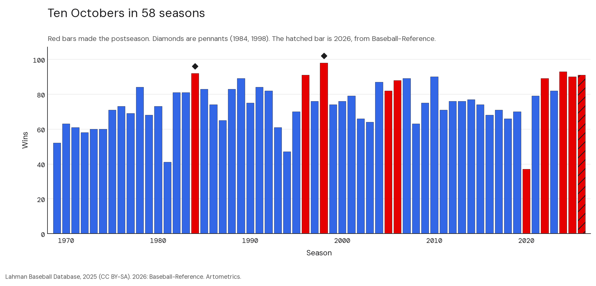
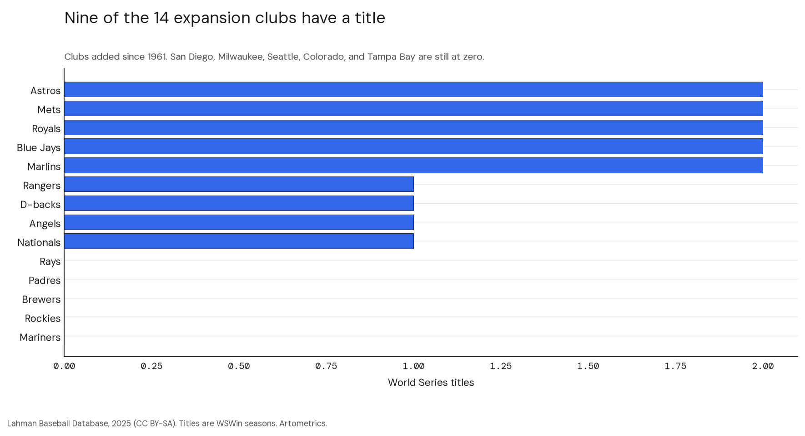
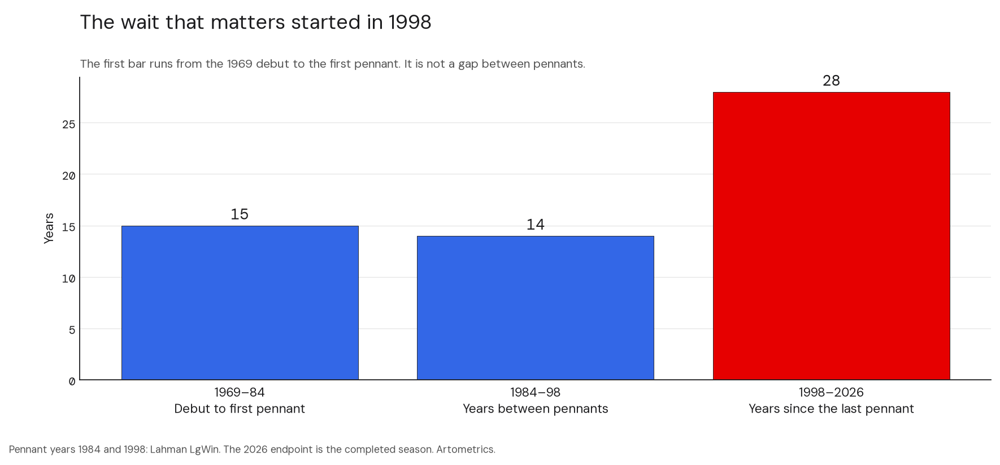
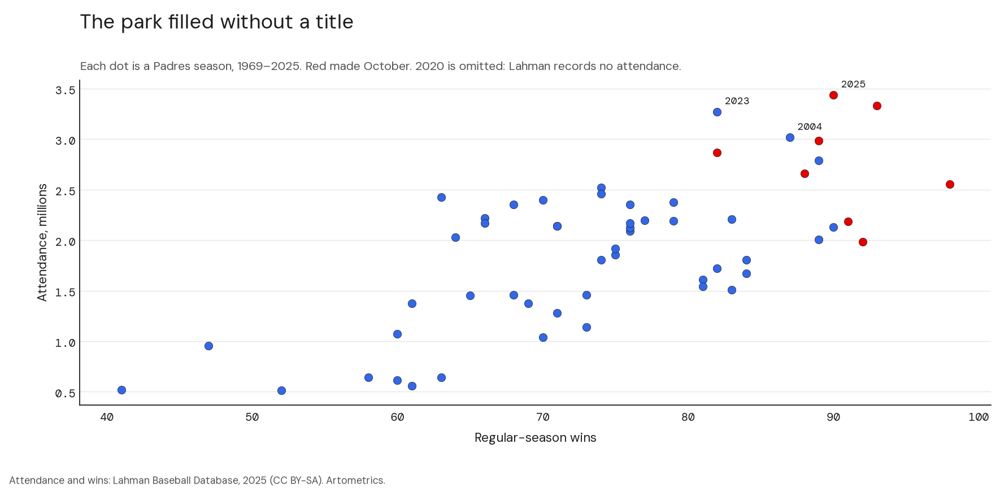
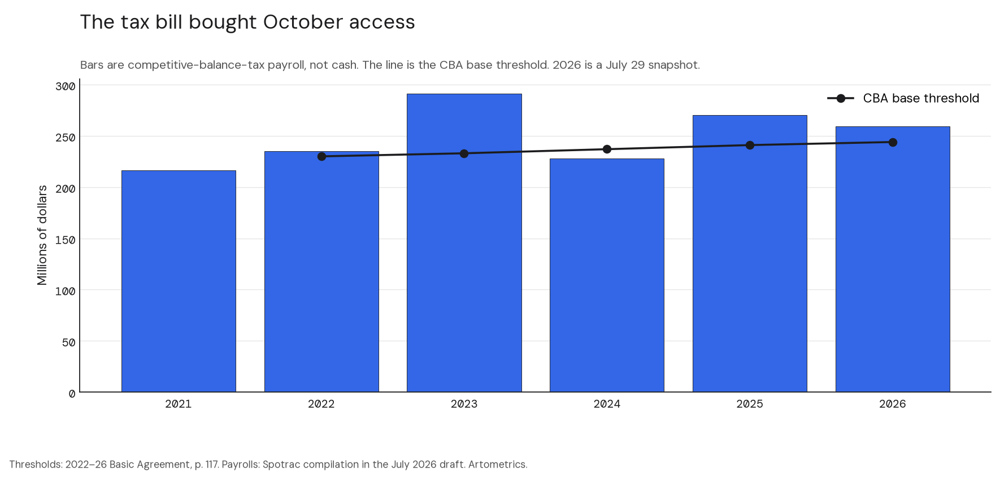
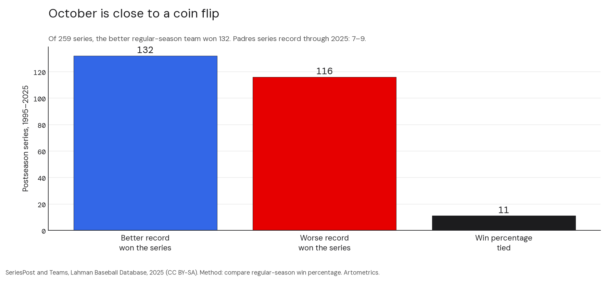

San Diego solved the two problems a mid-market club is supposed to fail. The park is full. The tax bill is paid. October is still close to a coin flip, and the franchise is on the wrong side of it. The market is paying a record price anyway. Franchise values follow the city and the building, not the trophy case.

## Executive summary

Five findings, for an owner, a lender, or the league office.

1. **The vote is in.** On August 17, 2026, Major League Baseball owners unanimously approved the transfer to José E. Feliciano and Kwanza Jones. Feliciano is the control person. Erik Greupner stays as chief executive. A.J. Preller stays in baseball operations. Associated Press and NBC 7 San Diego both reported the agreed price at $3.9 billion, an MLB record.
2. **Demand is not the missing piece.** In the Lahman file the club drew 3,437,201 in 2025, second in the majors, behind the Dodgers at 4,012,470. In 2026 Baseball-Reference records 3,347,081, second in the National League. Petco's first full era, 2004–19, averaged 2,372,417. The eight seasons before it, 1996–2003, averaged 2,292,236.
3. **October is a habit now, and still not a pennant.** Ten postseasons in 58 seasons. Two pennants, 1984 and 1998. The series record is 7–9 through 2025 and 8–10 after the 2026 wild-card win and the division-series loss. Nineteen of 57 Lahman seasons were winning seasons. 2026, at 91–71, is a twentieth.
4. **The $1.5 billion figure is a tax total, not cash.** The six competitive-balance-tax payrolls carried from the July draft sum to $1,500.1 million. The 2026 bar is a July 29 snapshot. The 2022–26 Basic Agreement sets the base threshold at $230 million, $233 million, $237 million, $241 million, and $244 million.
5. **The better team does not own October.** From 1995 through 2025, the club with the better regular-season winning percentage won 132 of 259 postseason series. The worse club won 116. Eleven series were tied on winning percentage. Among the 248 that were not tied, the better club won 53.2 percent. Lopez, Matthews, and Baumer (2018) place baseball as the most random of the four major North American leagues. A short series is built to behave like that.

The so-what is the same sentence for all five. A buyer who needs a title is buying a coin flip on top of a solved market. A buyer who needs appreciation is buying the market. Alexander and Kern (2004) find that market size, a new venue, and the chance of relocation explain franchise values, and that winning barely moves the price.

## The price of demand

The May agreement and the August vote are the same transaction seen from two desks. The family agreed to transfer control. The owners then approved it, unanimously, on a conference call on August 17, 2026. Major League Baseball's release said closing remained contingent on the weeks ahead; NBC 7 San Diego reported the new group could take operational control by the end of that week, with a press conference at Petco Park on August 24.

What the vote does prove is that the league accepted the price. Associated Press reported $3.9 billion at approval; NBC 7 San Diego reported the same figure and that the deal includes a 30 percent stake in Petco Park, subject to City of San Diego sign-off described as procedural. That is the venue half of the Alexander and Kern result, sitting inside the sale rather than beside it. A record price for a club with no championship is coherent if the thing being priced is a scarce big-league market attached to a modern ballpark. San Diego is that market. The trophy case is empty. The invoice does not seem to care.

## How the numbers were built

Data and method

The backbone is Lahman's Baseball Database, 2025 edition, seasons 1871–2025, released by the Society for American Baseball Research on January 2, 2026, under CC BY-SA 3.0. This report uses the Padres subset: Teams, SeriesPost, and TeamsFranchises. Derived tables are in <code>articles/padres/data/</code> and may be republished on the same terms with that credit. Rebuild the charts with <code>python3 articles/padres/scripts/build_charts.py</code>.

<strong>Samples.</strong> Padres seasons in Lahman, 1969–2025: n = 57. Seasons through the completed 2026 campaign: n = 58. Expansion clubs added since 1961: n = 14 (Angels, Rangers, Astros, Mets, Royals, Brewers, Padres, Nationals/Expos, Mariners, Blue Jays, Rockies, Marlins, Diamondbacks, Rays). Postseason series joined to both clubs' regular-season records, 1995–2025: n = 259. Padres postseason series through 2025: n = 16, record 7–9. With the 2026 wild-card win and division-series loss: 8–10.

<strong>2026.</strong> Record: 91–71, second in the NL West; attendance 3,347,081. Postseason: wild-card sweep of the Chicago Cubs, 2–0; division-series loss to the Milwaukee Brewers, 3–1 (Baseball-Reference team and postseason pages, read October 11, 2026). Those rows are not in the Lahman file. Sharing from Baseball-Reference is permitted with credit. They are not a bulk download.

<strong>Tax payroll is not cash.</strong> The bars in the payroll chart are competitive-balance-tax payrolls, an accounting average of contract values, as compiled by Spotrac for the July 31, 2026 draft. They are not checks written. The 2026 figure is the July 29 snapshot in that draft, not a closed season total. Thresholds for 2022–26 are the base numbers on page 117 of the Basic Agreement: $230 / $233 / $237 / $241 / $244 million. The 2021 threshold is not in that document, so the line starts in 2022. The six tax figures sum to $1,500.1 million.

<strong>Other caveats.</strong> The 2020 season was 60 games and is not grossed up. Lahman records Padres attendance of zero in 2020, so that season is off the attendance chart. 1981 and 1994 were shortened. A postseason is a year with at least one SeriesPost row, not a division flag alone. "Better record" means a higher regular-season win percentage. Payroll rank, the farm ranking, membership wait lists, and the direct-to-consumer subscriber count are not in this file. They are not repeated as facts.

## Fifty-eight seasons, ten Octobers

The red bars are the postseasons: 1984, 1996, 1998, 2005, 2006, 2020, 2022, 2024, 2025, and now 2026. The diamonds are the pennants. There are two of them. The hatched bar is 2026, which Lahman does not yet contain. Baseball-Reference has the club at 91–71, second in the National League West; a wild-card win over the Cubs, 2–0; and a division-series loss to Milwaukee, 3–1. The Brewers finished 103–59 in the regular season on the same site.

That is the new hook, and it is a mean one. The July draft used Milwaukee as the low-payroll alibi, a club that had reached October without spending like San Diego. The completed season has Milwaukee as the club that ended San Diego's year. The alibi club won the series.

The early history is a sequence of good years, not a regime. The 1984 club, built around Tony Gwynn, won the pennant and lost the World Series to Detroit, four games to one. The 1998 club won 98 and lost the World Series to a Yankees team that won 114, in a sweep. The 2005 and 2006 division titles came with 82 and 88 wins. Those are the win totals. They are thin. Calling them the thinnest credentials the division has ever sent to October is an opinion, and it is out.

Fourteen clubs have joined since 1961. Nine have won a World Series. The five that have not are the Padres, Brewers, Mariners, Rockies, and Rays. The table under the counterexamples is the decision tool: titles, pennants, postseasons, series record, pennants per postseason, and median attendance rank. Payroll rank is not in it. A current payroll table was not in the file.

Read the pennant chart from the left, carefully. The first bar is 15 years from the 1969 debut to the first pennant. It is not a gap between pennants, and the old axis title that called it one was wrong. The gap between the two pennants is 14 years. The gap since 1998 is 28 years, and it now holds the entire modern spending era and a record sale.

## Demand is solved

Wins and attendance do not move together. The cloud sits all over the chart. The step that matters is 2004, the first Petco Park season in the file: 3,016,752, after 2,030,084 the year before. The 2023, 2024, and 2025 seasons then set franchise records, ending at 3,437,201. Lemke, Leonard, and Tlhokwane (2010) treat attendance as a mix of team quality, weather, and promotions. San Diego's chart says the building did more work than the standings. Siegfried and Zimbalist (2000) and the later survey by Bradbury, Coates, and Humphreys (2023) are the caution on the public side of that building: stadiums rarely pay a city back. Erie, Kogan, and MacKenzie (2011) is the San Diego account of how Petco was financed. The dollar split of that deal is not reprinted here.

What can be said without a fresh club or trade press export is narrower. The club draws at a big-market rate in a market that is not Los Angeles, and Herzog and Sohn (2019) describe San Diego–Tijuana as one cross-border metropolis. No other major-league club has that border.

## The Preller doctrine and the tax bill

A.J. Preller has run baseball operations since 2014, and the August approval left him there. The method, as the club has practiced it, is to buy the present with the future. The pattern is the contracts on Machado, Tatis, and Bogaerts, and the 2022 trade that sent a Washington package including James Wood, MacKenzie Gore, and CJ Abrams for Juan Soto, who was then moved on. Dollar figures for those deals are not restated here. The win totals are in Lahman: 70 in 2019, 37 in the 60-game 2020 season, 79, 89, 82, 93, and 90 from 2021 through 2025. The floor rose. The pennant did not.

The bars sit on or over the league's base tax threshold from 2022 on. That is the point of the chart, and the limit of it. Hall, Szymanski, and Zimbalist (2002) find that, after free agency, payroll and wins in baseball move together. Rockerbie and Easton (2018) describe how revenue sharing and the tax change a mid-market club's reason to spend. San Diego spent. The wins followed, part of the way. Krautmann and Solow (2009) is the warning attached to the long deals: performance over a long contract is not flat. The 2021 season was a miss. 2022 beat a 111-win Dodgers team in the division series and lost the championship series to Philadelphia, four games to one. 2023 won 82. 2024 lost the division series to Los Angeles, three games to two, scoring zero runs in Games 4 and 5 (Baseball-Reference, 2024 NLDS). 2025 scored five runs in three wild-card games at Wrigley and lost the series, two games to one; the deciding game was a 1–3 loss (Baseball-Reference, 2025 NL Wild Card Series). The deciding games of those two seasons are the 0 and the 1.

## October is a lottery. San Diego still trails it

One hundred thirty-two, one hundred sixteen, eleven. That is the league's October from 1995 through 2025, once each series is tagged with the two clubs' regular-season winning percentages. The better club wins a little more than half the time when the percentages differ, and not more than that. Lopez, Matthews, and Baumer supply the reason to expect this. Baseball's season is long and its playoff is short. Randomness has room.

San Diego's own series record is the local version of the same fact. Seven wins and nine losses through 2025. Eight and ten after 2026. A .500 process will produce records like that. It will also, sometimes, produce a pennant. The Padres have had two. They have not had the third, and they have not had a title. Hakes and Sauer (2006) are the useful rebuke to any story that blames the lineup's style alone: markets do learn to price the skills that win. A failure repeated across this many series is allowed to be luck. It is not required to be only luck.

A full chart of October runs per game, regular season against postseason, is not in this revision. The 2025 wild card is five runs in three games on Baseball-Reference.

## The counterexamples

The useful clubs are not the Dodgers. Los Angeles is the outspend case, and this file does not contain a 2026 Dodgers payroll. The useful clubs are the ones that did something San Diego has not.

**Milwaukee Brewers.** Zero titles. One pennant. Eleven postseasons. A series record of 4–11. Median attendance rank 16. And, in 2026, the club that won the division series. If the new owners want a development model, this is the one that just beat them.

**Tampa Bay Rays.** Zero titles. Two pennants. A series record of 7–9 through 2025, the same as San Diego's. Median attendance rank 29, against San Diego's 17. The old alibi was payroll. The measured difference in this file is the gate. A current Rays payroll is not reprinted.

**Texas Rangers, 2023.** One title, in 2023, and three pennants. They are the expansion club that converted. This file does not say whether that season was bought or built. It says the conversion happened.

**Arizona Diamondbacks, 2001.** The franchise's first season in the file is 1998. The title is 2001. That is year four. One title, two pennants, a series record of 8–6. San Diego has had 58 seasons to produce the same object and has produced the attendance instead.

<table>
<caption>Expansion clubs since 1961. Lahman 2025. Payroll rank is omitted on purpose.</caption>
<thead>
<tr><th>Club</th><th>Debut</th><th>Titles</th><th>Pennants</th><th>Postseasons</th><th>Series</th><th>Pennants per postseason</th><th>Median attendance rank</th></tr>
</thead>
<tbody>
<tr><td>Mariners</td><td>1977</td><td>0</td><td>0</td><td>6</td><td>5–6</td><td>0.00</td><td>19</td></tr>
<tr><td>Rockies</td><td>1993</td><td>0</td><td>1</td><td>5</td><td>3–5</td><td>0.20</td><td>10</td></tr>
<tr><td>Brewers</td><td>1969</td><td>0</td><td>1</td><td>11</td><td>4–11</td><td>0.09</td><td>16</td></tr>
<tr><td>Padres</td><td>1969</td><td>0</td><td>2</td><td>9</td><td>7–9</td><td>0.22</td><td>17</td></tr>
<tr><td>Rays</td><td>1998</td><td>0</td><td>2</td><td>9</td><td>7–9</td><td>0.22</td><td>29</td></tr>
<tr><td>Nationals</td><td>1969</td><td>1</td><td>1</td><td>6</td><td>5–5</td><td>0.17</td><td>19</td></tr>
<tr><td>Angels</td><td>1961</td><td>1</td><td>1</td><td>10</td><td>5–9</td><td>0.10</td><td>9</td></tr>
<tr><td>Diamondbacks</td><td>1998</td><td>1</td><td>2</td><td>7</td><td>8–6</td><td>0.29</td><td>19</td></tr>
<tr><td>Rangers</td><td>1961</td><td>1</td><td>3</td><td>9</td><td>8–8</td><td>0.33</td><td>16</td></tr>
<tr><td>Marlins</td><td>1993</td><td>2</td><td>2</td><td>4</td><td>7–2</td><td>0.50</td><td>28</td></tr>
<tr><td>Blue Jays</td><td>1977</td><td>2</td><td>3</td><td>11</td><td>9–9</td><td>0.27</td><td>13</td></tr>
<tr><td>Royals</td><td>1969</td><td>2</td><td>4</td><td>10</td><td>10–8</td><td>0.40</td><td>22</td></tr>
<tr><td>Mets</td><td>1962</td><td>2</td><td>5</td><td>11</td><td>13–9</td><td>0.45</td><td>12</td></tr>
<tr><td>Astros</td><td>1962</td><td>2</td><td>5</td><td>18</td><td>18–16</td><td>0.28</td><td>14</td></tr>
</tbody>
</table>

Padres postseasons in the table stop at 2025, because that is the Lahman file. The 2026 trip is real and is not in the row. The Marlins are the rude comparison: two titles in four postseasons, and a median attendance rank of 28. Conversion and demand are different businesses. San Diego has the second of them.

## What the new owners are walking into

The labor agreement expires after the 2026 season. That is the live risk. A tax threshold, a surcharge, and a revenue-sharing rule are not background. They are the price of the roster the club just bought. Rockerbie (2020) is the adjacent market, the posting system, which matters for a club that has shopped the Pacific rim. Kunz (2017) is the history of the regional sports network, the machine that used to fund a local rights fee and no longer reliably does. 
Rottenberg (1956) is the old point underneath all of this. Talent moves toward revenue. Szymanski (2003) is the design problem: the playoff is a contest drawn to keep more clubs alive, which is why a solved market can still fail the last week. Chapin (2004) is the redevelopment comparison, Camden Yards and Cleveland, for anyone tempted to treat Petco as a unique civic miracle. It was a ballpark project. The attendance chart shows what it did for the gate. It does not show a title.

## Profiles

The franchise has had five relevant ownership ideas. Only two of them produced a pennant. The current one has produced a sale.

<aside>

Ray Kroc

1974. Bought a club that was headed out of town and kept it in San Diego.

John Moores

Sold the club in 2012. The attendance break in the file is 2004, the first Petco season. The public share of the building is a chapter in Erie, Kogan, and MacKenzie, not a number repeated here.

Peter Seidler

Control person after the 2020 season. Died in November 2023. The spending era is his. The trust litigation is not retold here.

</aside>

The people who still have to win the week are not the sellers.

<aside>

A.J. Preller

Baseball operations since 2014, and still there after the August vote. The doctrine is buy the present. The win floor rose. The pennant did not.

Tony Gwynn

Eight batting titles, on his Baseball-Reference page. The cultural franchise, and the center of the 1984 pennant club.

José E. Feliciano and Kwanza Jones

Approved August 17, 2026. Feliciano is the control person. They lead the group together. Greupner and Preller stay. NBC 7 San Diego reported a 30 percent Petco Park stake in the deal.

</aside>

Four clubs to keep on the desk when the first winter meeting starts.

<aside>

Milwaukee Brewers

Zero titles, one pennant, and the 2026 division series. The development comparison that just won.

Tampa Bay Rays

Zero titles, two pennants, the same 7–9 series record through 2025, and a median attendance rank of 29.

Texas Rangers, 2023

An expansion club that converted a season into a title. The file shows the title. It does not show the invoice.

Arizona Diamondbacks, 2001

A World Series in year four. The counterexample with a calendar attached.

</aside>

## What the buyer bought

<table>
<caption>The balance sheet a buyer can actually audit from this file.</caption>
<thead>
<tr><th>Line</th><th>What the file shows</th><th>What it does not show</th></tr>
</thead>
<tbody>
<tr><td>Demand</td><td>3,437,201 in 2025, second in the majors. 3,347,081 in 2026, second in the NL.</td><td>Memberships, prices, and the DTC subscriber count.</td></tr>
<tr><td>October access</td><td>10 postseasons in 58 seasons. Five of them since 2020.</td><td>A title.</td></tr>
<tr><td>Conversion</td><td>Series record 8–10 through the 2026 NLDS. Pennants in 1984 and 1998.</td><td>A reason to expect the next series to be different. The league rate is about a coin flip.</td></tr>
<tr><td>The tax bill</td><td>$1,500.1 million of competitive-balance-tax payroll, 2021–26, with 2026 still a July snapshot.</td><td>Cash spent. A fresh Spotrac export. The rank of that payroll.</td></tr>
<tr><td>The building</td><td>Attendance breaks in 2004. NBC 7 reports a 30 percent Petco stake in the sale.</td><td>The city's sign-off, and the public cost of the original project.</td></tr>
<tr><td>The clock</td><td>The labor agreement expires after 2026. Preller and Greupner stay.</td><td>Whether closing has happened. The farm rank. The remaining guarantees.</td></tr>
</tbody>
</table>

What to watch, in order. The closing. The final 2026 tax payroll, once someone has the export. The farm list, once FanGraphs or Baseball America is on the desk, because the July "last of 30" is not repeated blind. The guarantees on the long contracts, for the same reason. And the labor negotiation, because the threshold line on the payroll chart is a rule, and the rule expires.

The companion memo is the other side of the desk: where the balance sheet breaks, and what an owner would do first. It lives at [the blueprint](/blueprint). The Dodgers, Giants, and Yankees reports are the spending comparisons. None of them is the lesson. The lesson is the Brewers in October 2026, and the Diamondbacks in 2001.

## References

Lahman, S. (2026). *Lahman's Baseball Database, 1871–2025.* Society for American Baseball Research. Released January 2, 2026. CC BY-SA 3.0. [sabr.org/lahman-database](https://sabr.org/lahman-database/).

Sports Reference LLC. *2026 San Diego Padres statistics.* Baseball-Reference.com. [teams/SDP/2026](https://www.baseball-reference.com/teams/SDP/2026.shtml). *2025 NL Wild Card Series, Cubs over Padres (2–1).* [2025_NLWC2](https://www.baseball-reference.com/postseason/2025_NLWC2.shtml). *Tony Gwynn.* Eight batting titles listed on the player page. [gwynnto01](https://www.baseball-reference.com/players/g/gwynnto01.shtml).

Major League Baseball (August 17, 2026). *MLB owners unanimously approve Kwanza Jones and José E. Feliciano as new owners of the San Diego Padres.* [Press release](https://www.mlb.com/press-release/mlb-owners-approve-kwanza-jones-and-jose-e-feliciano-as-new-owners-of-the-san-diego-padres).

Associated Press (August 17, 2026). *MLB approves sale of San Diego Padres to José E. Feliciano and Kwanza Jones.* [AP News](https://apnews.com/article/padres-sale-jose-feliciano-5a634c7c83275de68bc71e784202fedc).

NBC 7 San Diego (August 17, 2026). *MLB owners approve San Diego Padres sale to group led by José E. Feliciano and Kwanza Jones* ($3.9 billion; 30 percent Petco Park stake). [Article](https://www.nbcsandiego.com/news/sports/san-diego-padres/mlb-owners-approve-san-diego-padres-sale-to-group-led-by-jose-e-feliciano-and-kwanza-jones/4062081/).

Major League Baseball and the Major League Baseball Players Association (2022). *2022–2026 Basic Agreement.* Base tax thresholds on p. 117. [PDF](https://registrationz.mlbpa.org/pdf/MLB%20Basic%20Agreement%202022-26.pdf).

Sports Reference LLC. *2026 San Diego Padres* (91–71; wild-card and division-series lines). [teams/SDP/2026](https://www.baseball-reference.com/teams/SDP/2026.shtml). *2026 NL Wild Card Series, Padres over Cubs (2–0).* [2026_NLWC2](https://www.baseball-reference.com/postseason/2026_NLWC2.shtml). *2026 NL Division Series, Brewers over Padres (3–1).* [2026_National_League_Division_Series_1](https://www.baseball-reference.com/bullpen/2026_National_League_Division_Series_1). *2024 NL Division Series, Dodgers over Padres (3–2).* [2024_NLDS2](https://www.baseball-reference.com/postseason/2024_NLDS2.shtml). *2025 NL Wild Card Series, Cubs over Padres (2–1).* [2025_NLWC2](https://www.baseball-reference.com/postseason/2025_NLWC2.shtml).

Lopez, M. J., Matthews, G. J., and Baumer, B. S. (2018). How often does the best team win? *The Annals of Applied Statistics*, 12(4), 2483–2516. [doi:10.1214/18-AOAS1165](https://doi.org/10.1214/18-AOAS1165).

Alexander, D. L., and Kern, W. (2004). The economic determinants of professional sports franchise values. *Journal of Sports Economics*, 5(1), 51–66. [doi:10.1177/1527002503251715](https://doi.org/10.1177/1527002503251715).

Hall, S., Szymanski, S., and Zimbalist, A. S. (2002). Testing causality between team performance and payroll. *Journal of Sports Economics*, 3(2), 149–168. [doi:10.1177/152700250200300204](https://doi.org/10.1177/152700250200300204).

Rockerbie, D. W., and Easton, S. T. (2018). Revenue sharing in Major League Baseball. *International Journal of Financial Studies*, 6(3), 71. [doi:10.3390/ijfs6030071](https://doi.org/10.3390/ijfs6030071).

Rockerbie, D. W. (2020). Revenue sharing and collusive behavior in the posting system. *Economies*, 8(3), 71. [doi:10.3390/economies8030071](https://doi.org/10.3390/economies8030071).

Hakes, J. K., and Sauer, R. D. (2006). An economic evaluation of the Moneyball hypothesis. *Journal of Economic Perspectives*, 20(3), 173–185. [doi:10.1257/jep.20.3.173](https://doi.org/10.1257/jep.20.3.173).

Siegfried, J., and Zimbalist, A. (2000). The economics of sports facilities and their communities. *Journal of Economic Perspectives*, 14(3), 95–114. [doi:10.1257/jep.14.3.95](https://doi.org/10.1257/jep.14.3.95).

Bradbury, J. C., Coates, D., and Humphreys, B. R. (2023). The impact of professional sports franchises and venues on local economies. *Journal of Economic Surveys*, 37(4), 1389–1431. [doi:10.1111/joes.12533](https://doi.org/10.1111/joes.12533).

Krautmann, A. C., and Solow, J. L. (2009). The dynamics of performance over long-term contracts. *Journal of Sports Economics*, 10(1), 6–22. [doi:10.1177/1527002508327382](https://doi.org/10.1177/1527002508327382).

Lemke, R. J., Leonard, M., and Tlhokwane, K. (2010). Estimating attendance at Major League Baseball games. *Journal of Sports Economics*, 11(3), 316–348. [doi:10.1177/1527002509337212](https://doi.org/10.1177/1527002509337212).

Szymanski, S. (2003). The economic design of sporting contests. *Journal of Economic Literature*, 41(4), 1137–1187. [doi:10.1257/jel.41.4.1137](https://doi.org/10.1257/jel.41.4.1137).

Rottenberg, S. (1956). The baseball players' labor market. *Journal of Political Economy*, 64(3), 242–258. [doi:10.1086/257790](https://doi.org/10.1086/257790).

Chapin, T. S. (2004). Sports facilities as urban redevelopment catalysts. *Journal of the American Planning Association*, 70(2), 193–209. [doi:10.1080/01944360408976370](https://doi.org/10.1080/01944360408976370).

Herzog, L. A., and Sohn, C. (2019). The San Diego–Tijuana cross-border metropolis. *Territory, Politics, Governance*, 7(2), 177–199. [doi:10.1080/21622671.2017.1323003](https://doi.org/10.1080/21622671.2017.1323003).

Kunz, W. M. (2017). The rise of the local: regional sports networks. *Journal of Sports Media*, 12(1), 141–168. [doi:10.1353/jsm.2017.0006](https://doi.org/10.1353/jsm.2017.0006).

Erie, S. P., Kogan, V., and MacKenzie, S. A. (2011). *Paradise Plundered.* Stanford University Press. [doi:10.1515/9780804782180](https://doi.org/10.1515/9780804782180).

Related Artometrics reports: [The Padres Cost $3.9 Billion. Winning Will Cost More.](/blueprint) · [Dodgers](/dodgers) · [Giants](/giants) · [Yankees](/yankees).

## Editor's note

Figures through 2025 are computed from the Lahman 2025 subset in this folder. The 2026 wins, attendance, runs, and series results were read from Baseball-Reference on October 11, 2026. Tax payrolls are a Spotrac compilation carried from the July 2026 draft and are labeled as tax payrolls, not cash. Payroll rank is omitted from the expansion table because no fresh export was attached to this revision.
