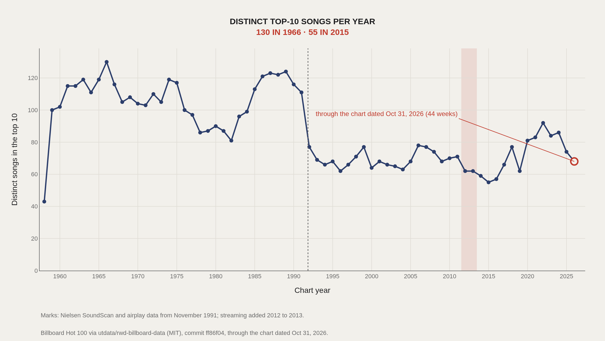
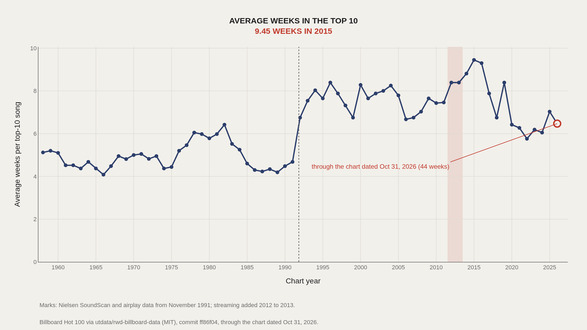
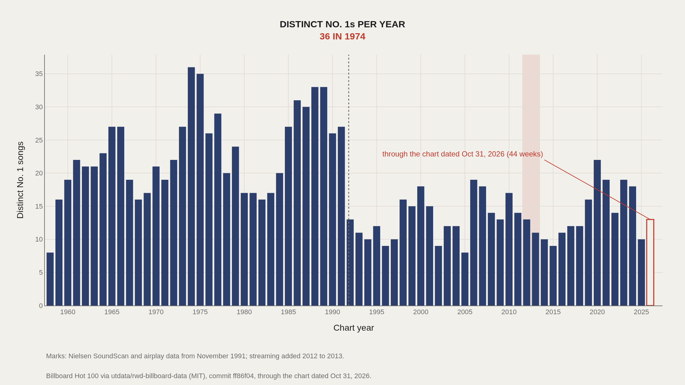
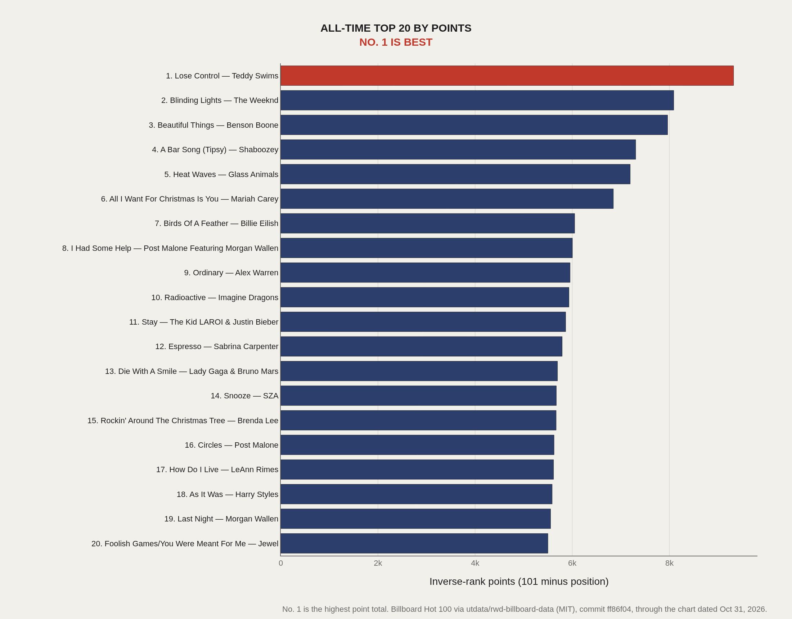
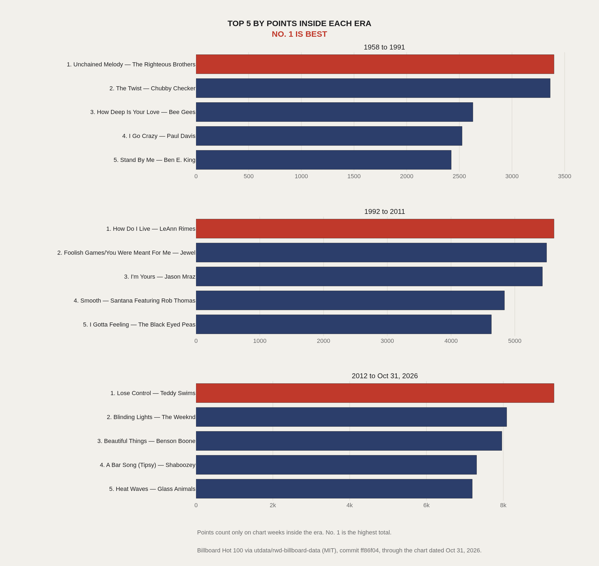

> **TL;DR** From the chart dated Aug 4, 1958 through the chart dated Oct 31, 2026, distinct songs in the Hot 100 top 10 peak at 130 in 1966 and 124 in 1989. The count is 77 in 1992 and 55 in 2015, the lowest year with 52 or 53 chart weeks. It reaches 92 in 2022. Scoring each week as 101 minus position puts Lose Control by Teddy Swims first, at 9,321 points. Those all-time totals favour recent songs: 16 of the top 20 first appear on a chart dated 2012 or later.

## Data and method {#data-and-method}

The weekly file is `data-out/hot-100-current.csv` from utdata/rwd-billboard-data at commit ff86f04. The repository code is MIT. The chart rows are Billboard's. This count keeps every row with `chart_week` on or before Oct 31, 2026: 3,561 chart weeks and 356,100 rows. Each week lists 100 positions. The first week is Aug 4, 1958, so 1958 has 22 chart weeks. The last week is Oct 31, 2026, so 2026 has 44.

A song is a title plus a performer. Before counting, both strings are normalized and nothing else is changed: case is folded; `&` is read as `and`; `ft.`, `feat.`, and `Featuring` are read as `featuring`; punctuation is removed; extra spaces are collapsed. Thirty-four pairs of raw credits collapse. They are listed in `data/merged_name_pairs.csv`. Covers with a different performer stay separate.

The previous version of this article ranked the stored week-position number upward, so songs observed at No. 100 came out as the leaders. Position 1 is the top of the chart.

Top 10 means positions 1 through 10. A No. 1 is position 1. For each calendar year of `chart_week`, the crowding table counts chart weeks, distinct songs anywhere on the Hot 100, distinct top-10 songs, distinct No. 1s, and the average number of top-10 weeks per top-10 song. That average is top-10 song-weeks divided by distinct top-10 songs, rounded half up to two decimals. On a complete chart the numerator is 10 times the number of weeks.

Points are a separate sum. Each listed position earns 101 minus the position: No. 1 earns 100 and No. 100 earns 1. On 13 chart weeks from Oct 6, 1990 through Dec 29, 1990, the file lists Unchained Melody by The Righteous Brothers at two positions. Both positions earn points. The song still counts once in the 1990 distinct-song totals. Neither of those positions is in the top 10.

Era charts sum only the weeks inside the calendar years 1958 to 1991, 1992 to 2011, and 2012 through the chart dated Oct 31, 2026. The time charts mark two rule changes: Nielsen SoundScan and airplay data from November 1991, and streaming added from 2012 to 2013. The marks are not the bin edges, and they are not a finding about why the counts moved.

## Fewer songs held the top 10, then more did {#fewer-songs-held-the-top-10-then-more-did}

1966 is the high point: 130 distinct top-10 songs across 53 chart weeks, an average of 4.08 weeks in the top 10. The other years of the 1960s run from 102 in 1960 to 119 in 1963 and again in 1965. The late-1980s high is 124 in 1989, an average of 4.19 weeks, with 121 in 1986, 123 in 1987, and 122 in 1988.

The count is 111 in 1991 and 77 in 1992. The dotted line on the chart marks November 1991, when Nielsen SoundScan and airplay data entered Billboard's Hot 100 rules. The count stays below the 1966 and 1989 highs after that year.

Among years with 52 or 53 chart weeks, the low is 55 songs in 2015, an average of 9.45 weeks in the top 10. The years around it are 62 in 2012, 62 in 2013, 59 in 2014, and 57 in 2016. The shaded band marks streaming added to the chart rules from 2012 to 2013.

From 2017 to 2022 the counts are 66, 77, 62, 81, 83, and 92. The path is not a rise every year: 2019 is 62, below 2018. The period ends at 92 distinct top-10 songs in 2022, across 53 chart weeks, an average of 5.76 weeks. 2025 has 74. The hollow marker is 2026, through the chart dated Oct 31, 2026 (44 weeks): 68 distinct top-10 songs.

The rest of the Hot 100 does not follow the same path. 1966 has 832 distinct songs anywhere on the chart, 1992 has 452, 2015 has 500, and 2022 has 764. The slowdown and the later rise in this chart are counts at positions 1 through 10.

## Average weeks move with that count {#average-weeks-move-with-that-count}

A full week has 10 positions in the top 10, so the average stay is the slot count divided by the distinct songs. 1966 averages 4.08 weeks. 1989 averages 4.19. 1992 averages 6.75. 2015 averages 9.45, the high among years with 52 or 53 chart weeks. 2022 averages 5.76. 2025 averages 7.03. The hollow marker is 2026: 6.47 weeks across 44 chart weeks.

## Distinct No. 1s peaked in 1974 {#distinct-no-1s-peaked-in-1974}

Distinct No. 1s peak at 36 in 1974. 1966 has 27. The late 1980s are high on this chart as well: 31 in 1986, 30 in 1987, 33 in 1988, and 33 in 1989. The count is 27 in 1991 and 13 in 1992. The lowest year with 52 or 53 chart weeks is 8 distinct No. 1s in 2005. 1958 also shows 8, across 22 weeks. 2015 has 9. 2022 has 14. 2025 has 10. The hollow bar is 2026: 13 distinct No. 1s in 44 weeks.

## All-time points put recent songs first {#all-time-points-put-recent-songs-first}

No. 1 on this chart is the highest point total. Lose Control by Teddy Swims has 9,321 points over 112 chart weeks, from Aug 26, 2023 through Oct 18, 2025. Blinding Lights by The Weeknd has 8,089 over 90 weeks, from Dec 14, 2019 through Sep 4, 2021. Beautiful Things by Benson Boone has 7,963 over 89 weeks, from Feb 3, 2024 through Oct 18, 2025.

Sixteen of the twenty songs first appear on a chart dated 2012 or later. The four earlier entries are All I Want For Christmas Is You by Mariah Carey (first week Jan 8, 2000, last week in this file Jan 3, 2026, 6,846 points), Rockin' Around The Christmas Tree by Brenda Lee (Dec 12, 1960 through Jan 3, 2026, 5,668 points), How Do I Live by LeAnn Rimes (5,615), and Foolish Games/You Were Meant For Me by Jewel (5,499). A sum of weekly points favours a song that spends many weeks near the top. In this file those songs are mostly recent, plus two Christmas titles that return across decades. The total is not a ranking by peak position.

## Inside each era, the leaders change {#inside-each-era-the-leaders-change}

Each panel sums only the chart weeks inside that span. No. 1 is the highest total in the panel.

From 1958 to 1991, the leader is Unchained Melody by The Righteous Brothers at 3,399 points. Then The Twist by Chubby Checker (3,363), How Deep Is Your Love by Bee Gees (2,629), I Go Crazy by Paul Davis (2,526), and Stand By Me by Ben E. King (2,423).

From 1992 to 2011, the leader is How Do I Live by LeAnn Rimes at 5,615. Then Foolish Games/You Were Meant For Me by Jewel (5,499), I'm Yours by Jason Mraz (5,433), Smooth by Santana Featuring Rob Thomas (4,838), and I Gotta Feeling by The Black Eyed Peas (4,633).

From 2012 through the chart dated Oct 31, 2026, the top five are Lose Control (9,321), Blinding Lights (8,089), Beautiful Things (7,963), A Bar Song (Tipsy) by Shaboozey (7,306), and Heat Waves by Glass Animals (7,193).

## What this data cannot tell you {#what-this-data-cannot-tell-you}

The file is a weekly ranking. It does not say why a song stayed, why the top-10 count fell, or why it rose. Nielsen SoundScan and airplay data from November 1991, and streaming added from 2012 to 2013, are marked because those are changes in Billboard's chart rules. The marks are not a finding that the rules caused the counts.

Normalization only folds case, `&` and `and`, featuring credits, and punctuation. Beautiful Things by Benson Boone (7,963) is not added to Beautiful Things by Megan Moroney. Songs whose credits differ only by the rules above are one song. The 34 merged pairs are in `data/merged_name_pairs.csv`.

2026 is 44 weeks, not a finished year. 1958 is 22 weeks. A lower song count in a short year is not the same fact as a lower count in a 52-week year.

Points summed across decades give more room to songs that chart for many weeks, including Christmas titles that return. They are not a list of the longest No. 1 runs, and they are not a year-end chart.

## What to take away {#what-to-take-away}

The top of the Hot 100 was most crowded in 1966, at 130 distinct top-10 songs, and again in the late 1980s, at 124 in 1989. The 1992 chart year has 77. The low among full chart years is 55 in 2015, which is 9.45 weeks in the top 10 per top-10 song. By 2022 the count is 92. The same weeks, scored as 101 minus position, rank Lose Control by Teddy Swims first at 9,321, and 16 of the top 20 first chart in 2012 or later.

## Sources {#sources}

Billboard Hot 100 chart data, via utdata/rwd-billboard-data (MIT), commit ff86f04, through the chart dated Oct 31, 2026. Billboard is the original data owner. https://github.com/utdata/rwd-billboard-data/blob/ff86f0456f55f8174ea5e91c0872a00df21b8603/data-out/hot-100-current.csv

Previous version's source: Data Science Learning Community. (2021). TidyTuesday: Billboard Top 100. https://raw.githubusercontent.com/rfordatascience/tidytuesday/main/data/2021/2021-09-14/billboard.csv

<!-- Previous version based on the 2021 TidyTuesday extract, hidden on Oct 31, 2026 and kept for reference:
> **TL;DR** The Billboard Hot 100 is a weekly ranking machine: 100 positions, endlessly refreshed. The TidyTuesday billboard extract used here holds 100,000 song-week rows, with a median week position of 50.0 — exactly mid-chart — and a highest observed week position of 100 (the bottom rung).

The Billboard Hot 100 is a weekly ranking machine: 100 positions, endlessly refreshed. The TidyTuesday billboard extract used here holds 100,000 song-week rows, with a median week position of 50.0 — exactly mid-chart — and a highest observed week position of 100 (the bottom rung).

That median of 50 is almost tautological in a full 1–100 ranking, which is why the interesting questions shift to concentration, re-entries (instance), and which titles spend time at the chart’s edges. “Down By The River” appears among the fact-box leaders for week position in this working file.

## Data and method {#data-and-method}

The source is the TidyTuesday release from 2021-09-14 (billboard.csv). After cleaning, the analysis sample contains 100,000 records.

Week position is the primary metric; lower numbers are better ranks in Billboard’s native scale, but several charts here rank the numeric position field directly as stored. Charts are Plotly JSON with PNG fallbacks.

## Song-Level Position Averages Crowd the Bottom Rung {#song-level-position-averages-crowd-the-bottom-rung}

### Week position by Song

When songs are ranked by week-position summaries, a block of titles ties at 100 — including Girl (You Captivate Me), Time Seller, Gee Baby (I’m Sorry), and others. Those are songs whose observed positions in this aggregation sit at the chart floor.

The chart is less a hall of fame than a map of how many titles live at the margins of the Hot 100’s attention economy.

## Leaders by Week Position Are a Flat Elite {#leaders-by-week-position-are-a-flat-elite}

### (Quarter To Four) Stomp leads at 100 — 100 marks the median among the top dozen

(Quarter To Four) Stomp and peer titles in the leaders view hit 100, and the median among the top dozen is also 100. There is no graded ladder here — the “leaders” by this numeric field are a plateau at the bottom rank.

That flatness is informative: many songs brush the Hot 100 without climbing. Presence is not the same as dominance.

## Weekly Positions Fill the Chart Almost Uniformly {#weekly-positions-fill-the-chart-almost-uniformly}

### Week position Distribution

The distribution of week positions across the 100,000-row sample is remarkably even: bin counts hover near 5,000 observations across the 1–100 range. A full Hot 100 every week produces that rectangular shape by design.

Uniform position counts are the baseline. Deviations in other charts — concentration among songs, re-entry instances — are where the cultural story lives.

## Concentration Among Songs Is Mechanical at First {#concentration-among-songs-is-mechanical-at-first}

### Cumulative Week position

The Pareto curve over leading song entries rises in near-equal steps in this view, reaching 100% by the fifteenth plotted entry. Within the restricted leader set, share accumulates steadily rather than in a single spike.

Full-catalog fame concentration is a different question; this curve describes the ranked subset on display, not every Hot 100 occupant since the 1950s.

## Re-Entries Stretch a Song’s Life Without Guaranteeing Rank {#re-entries-stretch-a-song-s-life-without-guaranteeing-rank}

### Week position vs Instance

Week position versus instance (re-entry or appearance count) shows titles returning to the chart at many ranks. High instance values appear across both strong and weak positions.

Longevity on Billboard is not only about peaking at No. 1. It is also about how many times a song is allowed to reappear — a second career path the scatter makes visible.

## What this file cannot tell you {#what-this-file-cannot-tell-you}

Billboard’s chart methodology has changed over decades (sales, airplay, streaming). A pooled file mixes eras with different rules. Song-title collisions and punctuation variants can split or merge identities.

Numeric “leaders” by week position in this stack highlight the bottom of the chart, not the cultural canon. Read rank direction carefully before citing.

## What to take away {#what-to-take-away}

A 100,000-row Hot 100 extract is mostly a uniform grid of weekly ranks — median 50, full coverage from 1 to 100. The drama is in which songs repeatedly occupy that grid and which only touch position 100.

Cite the uniform distribution when explaining the chart’s structure; cite instance versus position when explaining how hits persist.

## Sources {#sources}

Data Science Learning Community. (2021). TidyTuesday: Billboard Top 100. https://raw.githubusercontent.com/rfordatascience/tidytuesday/main/data/2021/2021-09-14/billboard.csv
-->
