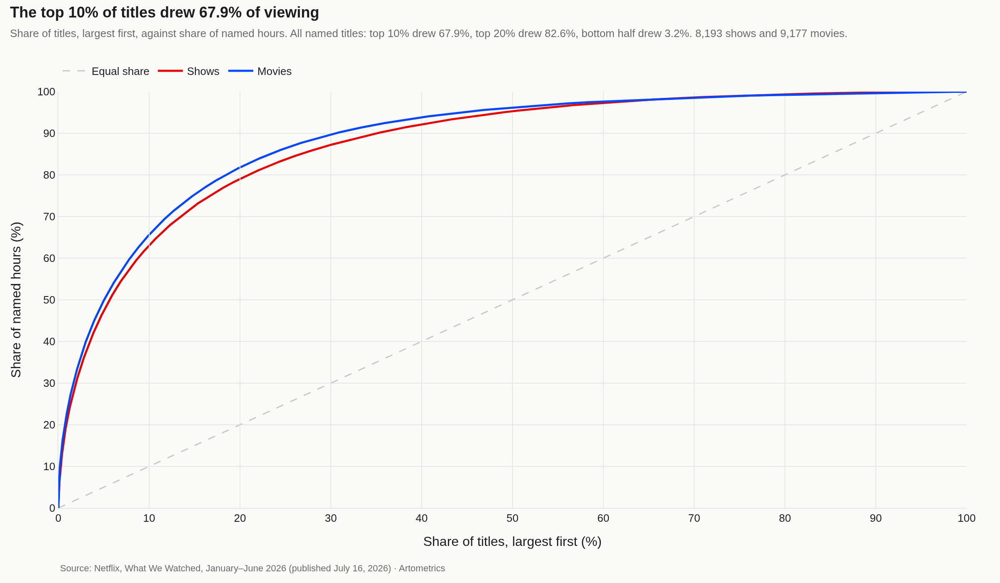
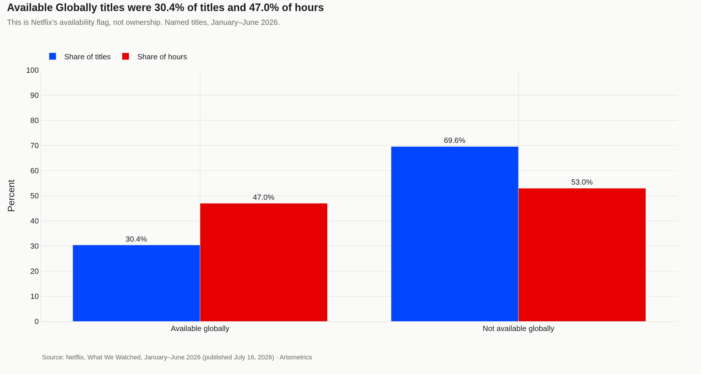
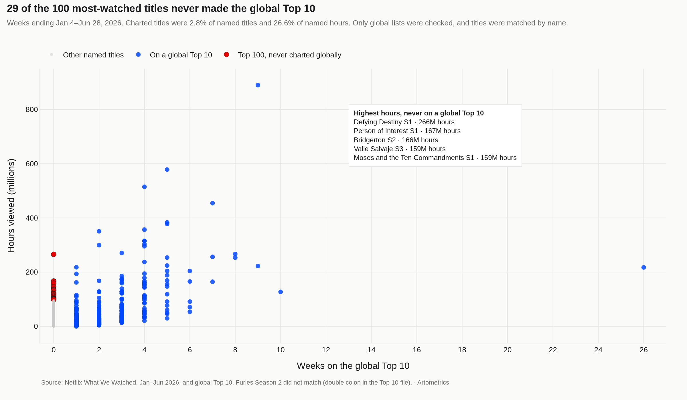

> **TL;DR** Netflix's What We Watched report for January–June 2026 lists 17,370 titles with at least 50,000 views worldwide (8,193 shows and 9,177 movies), accounting for 96.80 billion named hours. The top 10% of those titles drew 67.9% of named hours, and the top 20% drew 82.6%. No public dataset measures homepage promotion or how many properties a platform markets in a quarter.

Netflix's What We Watched report for January–June 2026 lists 17,370 titles with at least 50,000 views worldwide — 8,193 shows and 9,177 movies — and 96.80 billion named hours. The top 10% of those titles drew 67.9% of named hours, and the top 20% drew 82.6%. No public dataset measures homepage promotion or how many properties a platform markets in a quarter.

This report measures how viewing concentrated across that disclosed list, and how many of those titles also appeared on Netflix's weekly global Top 10. Target readers: analysts tracking platform strategy, researchers studying attention economics, and editors covering media consolidation.

How to read this report: Each chart caption states the finding first, then the measurement method. Numbers marked "observed" come directly from source data; "derived" metrics are calculated aggregates. Check the limitations section before citing any figure.

## DATASET CONTEXT {#dataset-context}

This analysis uses Netflix's What We Watched engagement report for January–June 2026, published July 16, 2026, and the global weekly Top 10 file (all-weeks-global.tsv) from Netflix Tudum, read October 30, 2026. Named titles are every row except Other Shows and Other Movies: 8,193 shows and 9,177 movies, 17,370 titles, 96.80 billion hours.

Titles were matched to the global Top 10 by name for weeks ending January 4 through June 28, 2026. The chart name is the season title when Netflix publishes one, otherwise the show title, compared with the English name in the engagement report (the text before " // "). A parenthetical year is ignored when the rest of the name matches. One charted name did not match because of a double colon in the Top 10 file: "Furies: Season 2: : Resistance" against "Furies: Season 2: Furies: Resistance." 488 of 489 charted names matched. Only global lists were checked.

Methodology and source documentation: https://artometrics.com/methodology/

## HOW BIG IS THE LIBRARY — AND HOW TOP-HEAVY? {#library-shape}

Of the 17,370 named titles, the top 10% drew 67.9% of named hours and the top 20% drew 82.6%. The bottom half of titles drew 3.2% of named hours. The curves separate shows from movies, counting each title's share within its own kind.

Named titles exclude the Other Shows and Other Movies rows. Those rows cover viewing of titles under 50,000 views, and video podcasts are included under Other Shows, so the named hours are not 100% of viewing on Netflix in the half.

## CONCENTRATION: WHO OWNS THE MIDDLE OF THE SHELF? {#concentration}

Neither Netflix file names a studio or a rights holder. The engagement report does mark whether a title was Available Globally. Titles marked yes were 30.4% of named titles and 47.0% of named hours.

That column is Netflix's availability flag, not a measure of ownership. No public dataset measures homepage placement.

## THE AVAILABILITY GAP: HYPE VS WHAT STAYS UP {#availability-gap}

Titles that appeared on a weekly global Top 10 in the weeks ending January 4 through June 28, 2026 were 2.8% of named titles and drew 26.6% of named hours. Of the 100 most-watched named titles, 29 never appeared on those lists.

Only global lists were checked, and titles were matched by name. One charted name did not match: the Top 10 file lists "Furies: Season 2: : Resistance" (a double colon), while the engagement report lists "Furies: Season 2: Furies: Resistance." 488 of 489 charted names matched. No public dataset measures which titles a recommendation system repeats.

## LIMITATIONS {#limitations}

Named hours exclude the Other Shows and Other Movies rows. The list is titles with at least 50,000 views worldwide in January–June 2026, not a count of the full catalog and not a US-only inventory. The hours are Netflix's, for the half it chose to publish.

Only global Top 10 lists were checked. A title absent from those lists may still have charted on a country list. Titles were matched by name. The Furies Season 2 row in the Top 10 file uses a double colon ("Furies: Season 2: : Resistance") and did not match "Furies: Season 2: Furies: Resistance" in the engagement report; 488 of 489 charted names matched. When several engagement rows shared a name, the match kept the exact English name, then the row with more hours. Available Globally is Netflix's availability flag, not ownership. No public dataset measures homepage promotion or a quarterly marketing count.

## CONCLUSION {#conclusion}

On this list, a small share of titles carries most of the viewing: the top 10% drew 67.9% of named hours, and the top 20% drew 82.6%. Titles that reached the global Top 10 were 2.8% of the list and 26.6% of named hours.

The best use of these charts is to sharpen questions about platform strategy and attention economics, not to make claims about homepage promotion, marketing spend, or content quality. Those are not in this file. Check the source notes before citing any figure.

## REFERENCES {#references}

Netflix, "What We Watched the First Half of 2026," July 16, 2026: https://about.netflix.com/news/what-we-watched-the-first-half-of-2026

Netflix Top 10, global weekly lists (all-weeks-global.tsv), weeks ending January 4 through June 28, 2026, file read October 30, 2026: https://www.netflix.com/tudum/top10

User-supplied or public streaming availability export: https://artometrics.com/methodology/

Related Artometrics reports: anime · franchise

## EDITOR'S NOTE {#editors-note}

Charts and counts in this report are computed from Netflix's January–June 2026 What We Watched workbook and the global Top 10 file. The named-title census is 17,370 (8,193 shows and 9,177 movies). One global Top 10 name, Furies Season 2, did not match because the Top 10 file contains a double colon. Last updated: 2026-10-30.
